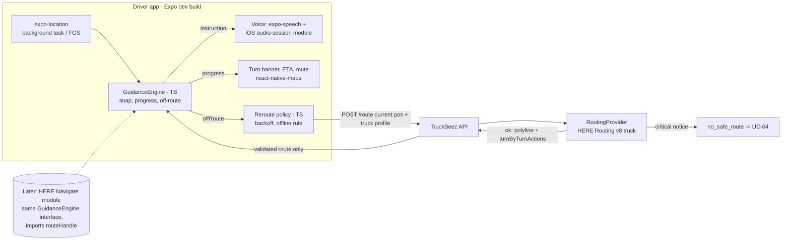

# ADR-0002: In-app turn-by-turn navigation

| | |
|---|---|
| **Status** | Proposed: owner decides |
| **Date** | 2026-11-07 |
| **Jira** | BR-54 (gates BR-5, BR-32; touches BR-31) |
| **Deciders** | Dayo Sodimu (owner) |
| **Author** | truckbeez-ai-agent-architect |
| **Consult** | uiux-designer (voice and guidance flows), fullstack-engineer (native module, API contract), qa-automation-engineer (simulated GPS), security-engineer (background location, store review) |
| **Depends on** | ADR-0001 (PR #9): HERE Routing API v8, server-side, behind `RoutingProvider` |

Facts that could not be confirmed from a vendor or platform document are marked **(unverified)**. Effort and battery figures are estimates until the spike runs.

## Context

The driver app is Expo / React Native (TypeScript). The starter app on `fix/BR-51-safe-here-routing` uses Expo SDK 52, React Native 0.76, `react-native-maps` and `expo-location`. Routes come only from our API, which calls HERE Routing v8 with the full truck profile and hazmat goods, and **discards any route that carries a critical notice** (`no_safe_route`, UC-04). That server check is our only guarantee of hazmat and dimensional correctness, so navigation must not create routes that skip it.

UC-05 (BR-32) and BR-5 need: spoken turn instructions, map that follows the truck, automatic reroute when off route, guidance with the screen locked or the app in the background, one-tap mute, a "Searching for GPS" state that keeps the last route, and UC-04 when a reroute finds no safe route.

Owner constraints: voice-first and glanceable, no typing while moving; hazmat correctness beats speed; **battery at most 7% per hour while navigating**; Appium is the preferred E2E tool; US-first; hazmat carriers from Phase 1.

Two facts frame the whole decision:

1. **Every option needs a development build.** Expo Go cannot run background location on either platform ("You must use a development build to use background location since it is not supported in the Expo Go app"; "Foreground and background services are not available in Expo Go for Android"). Expo's supported way to add native code is the Expo Modules API (Swift and Kotlin) plus config plugins, with native folders regenerated by prebuild. So "stay in Expo Go" is not a reason to prefer B over A.
2. **The HERE SDK does not reroute by itself.** "The HERE SDK does not recalculate routes automatically"; it reports deviation and the app decides. So with option A, *we* choose where a reroute comes from. That is what makes A compatible with server-only routing.

## Options

### A. HERE SDK (Navigate license) wrapped as an Expo native module

A Swift and Kotlin Expo module exposes a HERE `MapView` and the `Navigator` to JS. The server adds `routeHandle` to its HERE request and returns it with the validated route; the app imports it with `importRoute(RouteHandle)` and starts guidance. On deviation the module emits an event; JS asks our API for a new route and imports that.

- Navigate is "only available for customers who have signed a contract with HERE Technologies". Platforms: native Android, native iOS, Flutter. **No React Native SDK.** The Flutter reference app says Navigate evaluation credentials are "only available upon request".
- Truck guidance exists: truck routing via `TruckOptions` (hazardous goods, tunnel category B to E) and a listener for "truck restrictions ahead, such as narrow tunnels" during guidance.
- Offline maps, offline search and offline routing are Navigate features.
- Catch for hazmat integrity: route import "is not a 1:1 import"; HERE says "importing a route may not always reproduce exactly the same route as the original one", and a route handle "requires an online connection" and is "only valid for a couple of hours". The imported route can therefore differ from the one our server checked.

### B. Our own guidance engine on the server route (recommended now)

The API returns the validated route's polyline plus HERE `turnByTurnActions` (manoeuvres with road names, "which enables turn-by-turn guidance support"). A TypeScript guidance engine in the app:

- snaps `expo-location` fixes (`Accuracy.BestForNavigation`, background task, Android foreground service) to the polyline;
- tracks progress and speaks the next action at distance thresholds (US units: 1 mi, 0.25 mi, "now");
- detects off-route (distance plus heading over several fixes) and asks **our API** for a new route from the current position;
- keeps the last route and dead-reckons along it while GPS is lost (tunnels), showing "Searching for GPS".

Voice: `expo-speech` (AVSpeechSynthesizer / Android TTS) **plus a small native audio-session module on iOS**, see Risk R1.

### C. Rewrite the driver app in Flutter with HERE SDK for Flutter (Navigate)

HERE supports Flutter officially and ships a Flutter reference app covering search, planning and turn-by-turn navigation, including a truck mode. It needs the same Navigate contract as A, plus rewriting the existing React Native driver and fleet screens, a second mobile toolchain, and a different E2E approach.

### Ruled out: other SDKs on our HERE route

ADR-0001 already rules out mixing engines: each navigation SDK only guides its own engine's routes. Two more points from this review:
- Google's React Native Navigation SDK is **beta** ("in Beta until it reaches version 1.0"; breaking changes "at any time" in 0.x) and needs React Native 0.87+ with the New Architecture. Google Large Vehicle Routing has no class 7 routing (ADR-0001).
- The TomTom Navigation SDK is native Android and iOS only; it is not React Native or Flutter.

## Comparison

| Criterion | A. HERE Navigate in Expo module | B. Own guidance on server route | C. Flutter + HERE Navigate |
|---|---|---|---|
| **Hazmat integrity on reroute** | Good **if** reroutes always come from our API and the imported shape is checked against the server polyline (import can differ). SDK offline routing would bypass the server check, so it must be disabled or gated (see Decision 4). | **Best.** One source of routes: the server with critical-notice discard. The app cannot create a route. | Same as A. |
| **Offline and tunnels** | **Best.** Offline maps, offline routing, map matching in the SDK. | Route and actions cached at start, so guidance continues offline and in tunnels on the current route. **No offline reroute.** Map tiles from `react-native-maps` are not guaranteed offline **(unverified)**. | Same as A. |
| **Battery (7%/h budget)** | Unknown; vector map rendering plus GPS **(unverified, measure)**. | Unknown; GPS at navigation accuracy plus a screen-on map is likely to dominate in all options **(unverified, measure)**. JS snapping cost is small. | Same as A. |
| **Licensing and cost** | Contract only, MAU-based. HERE's commercial terms list a "HERE SDK (Navigate)" MAU plan column; the price is not public. Lead time for contract and eval credentials is unknown. | No new licence. Uses Routing v8 transactions already in ADR-0001; reroutes add transactions. **Need to confirm** HERE terms allow our own turn-by-turn from Routing v8 responses **(unverified)**. | Same contract as A. |
| **Effort (estimate)** | 6 to 10 engineer-weeks for both platforms: native map view, navigator events, voice, config plugin, plus contract lead time. | 3 to 4 engineer-weeks for an MVP guidance engine, voice, reroute, background, tests. | 3+ months: rewrite driver and fleet screens, new CI, new tests. |
| **Appium testability** | Medium. RN controls testable via `testID`; the HERE map is an opaque native surface; voice needs test hooks. | **Best.** RN controls via `testID`; GPS driven by Appium `setGeolocation`, Android emulator GPX or `simctl location`; the engine itself is pure TS, so recorded traces run in Vitest without a device. | Weakest fit: Flutter needs the Flutter Appium driver or `integration_test` **(unverified)**; conflicts with "Appium preferred". |
| **App Store / Play review** | Same as B: needs `location` and `audio` background modes and a user-facing reason. | iOS: background `location` (and `audio` for voice). Apple has rejected apps where background location was used "for the sole purpose of tracking employees" (2.5.4), so **navigation must be the user-facing reason** and fleet sharing must ride on it. Android: foreground service of type location started by the "Start" tap; Play lists turn-by-turn as a typical foreground use; fleet tracking outside navigation needs the background-location declaration and a video. | Same as A. |
| **Driver safety (voice, glanceable)** | SDK provides tested manoeuvre logic and voice text in many languages. | We own announcement timing; risk of late or missing prompts until tuned with real traces. | Same as A. |

## Hybrid: B now, A later

It works, if we build the seam on day one:

1. **One route contract.** The API returns `{ routeId, profileHash, polyline, actions[], notices: [], routeHandle? }` from the validated route only. B uses polyline and actions; A later uses `routeHandle` and compares the imported shape against `polyline`.
2. **One app interface.** `GuidanceEngine` in the app: `start(route)`, `stop()`, events `progress`, `instruction`, `offRoute`, `gpsLost`, `arrived`. B is the TS implementation. A becomes a native implementation behind the same interface. The reroute policy (always ask the API) stays in shared TS, not in either engine.
3. **Voice and UI are ours in both.** The turn banner, ETA card, mute button and UC-04 sheet stay React Native components, so the UI/UX work and Appium tests carry over.

What gets thrown away when moving to A: the TS snapping and announcement logic and probably `react-native-maps` (HERE's map view replaces it). Keep these small and well tested so the loss is cheap. Triggers to move to A: spike or pilot shows unreliable guidance in tunnels or dense interchanges, pilot fleets require offline reroute, or B misses the battery budget where A measurably meets it.

## Decision (proposed)

1. **Adopt option B for Phase 1**, behind the `GuidanceEngine` interface above, so A can replace it later without UI or API changes.
2. **Routes come only from the API.** No component in the app may compute a route. A reroute is a new `POST /route` from the current position with the same truck profile; `no_safe_route` goes to UC-04.
3. **Off-route policy:** off route means more than 50 m from the polyline with a heading mismatch for 3 consecutive fixes (tune in the spike). Back off reroute requests (at most one every 10 s) to limit HERE transactions.
4. **No new road segments without the server.** When offline, guidance continues on the cached route only. If the driver leaves it while offline, say "Off route. No connection to check a safe route." once and retry the API when the connection returns. This rule also binds A: if A is adopted, SDK offline routing stays off until security and the owner approve a gated version (SDK route computed with the same `TruckOptions`, any restriction notice discards it, and it is marked provisional).
5. **iOS voice uses a native audio session** (Expo module, about 100 lines of Swift): category `playback`, mode `voicePrompt`, options `duckOthers` and `interruptSpokenAudioAndMixWithOthers`. Apple describes `voicePrompt` as the mode for "a turn-by-turn navigation app that plays short prompts".
6. **Ask HERE for Navigate pricing and eval credentials now**, in parallel, so a later switch to A is not blocked by contract lead time.
7. **Reject option C.** It costs a rewrite and a weaker Appium story for the same SDK that A gives us.

## Risks

| # | Risk | Likelihood | Impact | Mitigation |
|---|---|---|---|---|
| R1 | **iOS speech stalls with the screen locked.** A developer using `expo-speech` with `audio` and `location` background modes reports that speech "reliably pauses mid-utterance the moment the screen locks" and resumes only on unlock; no answer on Apple's forum. Also, `expo-speech` "won't produce sound if the device is in silent mode". | High | Critical: missed turns with a locked phone | Native audio-session module (Decision 5). Spike exit criterion 2. Fallback: synthesize prompts to audio files ahead of each manoeuvre and play them with the audio player. |
| R2 | Late or wrong announcements in complex interchanges (we own the timing logic). | Medium | High | Replay recorded truck traces in CI; tune thresholds by speed; keep "now" prompts short. UI/UX owns wording. |
| R3 | Battery over 7%/h. | Medium | Medium | Measure in the spike with fixed brightness; dim map after a stable stretch; lower GPS rate on long straight segments. |
| R4 | HERE terms restrict building our own guidance from Routing v8 **(unverified)**. | Low to medium | High | Security agent reads the HERE terms (ties to ADR-0001 item 5). If restricted, A becomes required. |
| R5 | App Store 2.5.4 rejection because reviewers see fleet tracking as the purpose of background location. | Medium | High | Background location only while navigating or on duty with navigation; show the blue background indicator; review notes describe navigation as the feature. |
| R6 | Reroute storms (GPS noise near the route) burn HERE transactions and annoy drivers. | Medium | Medium | Heading check, 3-fix rule, 10 s backoff; zero false reroutes is an exit criterion. |
| R7 | Option A later: imported route differs from the checked one. | Medium | Critical | Compare imported shape to the server polyline; reject and fall back to B guidance if it diverges beyond a set distance. |
| R8 | GPS loss in long tunnels or urban canyons gives wrong progress. | Medium | Medium | Dead reckon along the polyline at last speed; never reroute during GPS loss; "Searching for GPS" banner. |

## 1-day spike plan (option B)

**Status: not run yet.** BR-54 asks for a spike result; this environment has no devices and no npm registry, so the full-stack engineer should run it (or this agent on a machine with devices).

**Setup (morning):** Expo dev build of the starter app on one mid-range Android phone and one iPhone. API returns polyline plus `turnByTurnActions` for one fixed hazmat profile route (for example, a class 3 tanker route around a known tunnel restriction in NY/NJ). A minimal TS `GuidanceEngine` with snapping, thresholds and off-route; the iOS audio-session module. In parallel, email HERE sales for Navigate eval credentials and pricing.

**Runs (afternoon):** replay a GPX trace (Android emulator GPX and `simctl location`, then a real drive or a phone-on-dashboard ride if possible).

| # | Exit criterion | Pass |
|---|---|---|
| 1 | Announcement timing | At least 95% of manoeuvres announced within ±15% of the target distance; 100% get a "now" prompt before the manoeuvre point |
| 2 | Locked screen and silent switch, iOS | 20 of 20 prompts complete with screen locked, silent switch on, music playing (ducked); each finishes within 1.5x its unlocked duration |
| 3 | Screen off, Android | 20 of 20 prompts with the foreground-service notification visible |
| 4 | Off-route detection | Wrong exit triggers a reroute request within 10 s; **0** reroutes during 10 min on route with GPS noise |
| 5 | Reroute integrity | 100% of new routes come from `POST /route` (logged); a forced `no_safe_route` shows UC-04 and **no** route is drawn from the app |
| 6 | GPS loss (tunnel) | 60 s with no fixes shows "Searching for GPS", keeps the route, triggers no reroute, and resumes guidance on the next fix |
| 7 | Battery | 60 min of navigation at 50% brightness: at most 7% drain on both phones (record start and end %, device model, OS) |
| 8 | Appium | One Appium smoke test on the Android emulator: start navigation, step `setGeolocation` along 5 points, assert the turn banner text changes, assert mute toggles |
| 9 | Latency | Reroute round trip (request to new banner) p95 under 3 s on LTE **(target proposed, owner to confirm)** |

**Outcome rule:** criteria 2, 4, 5 and 7 are blocking. If 2 fails after the audio-session fix and the pre-synthesized fallback, or 7 misses by more than 2 points, re-open this ADR in favour of A.

## Consequences

### For BR-5 and BR-32 (UC-05)
- **API change (full-stack):** HERE request adds `turnByTurnActions` and US units and language (`lang=en-US`, imperial units, **param names unverified**). The current `RouteResult.instructions: string[]` loses positions; replace with `actions[]` (offset into the polyline, length, duration, road names) plus `routeId` and `profileHash`. Optionally add `routeHandle` to keep the A path open.
- **App (full-stack):** Expo dev builds become the only way to run the app (EAS or local). Add `GuidanceEngine`, reroute policy, iOS audio-session Expo module, location config plugin settings (`UIBackgroundModes` location and audio, Android FGS type location).
- **UC-05 flows:** 2a reroute and 2d UC-04 work as written, through the server. 2b background voice depends on R1. 2c "Searching for GPS" matches Decision 4 and R8. 3a mute is a large single button, also by voice.
- **UC-04 during navigation (UI/UX, owner):** when a reroute returns `no_safe_route`, the old route was safe but the truck has left it. Proposed: voice "No truck-safe route from here. Stop when safe." and the UC-04 sheet once stopped; no route drawn from the current position. Needs a UX decision.
- **Open questions in BR-32:** lane guidance is not in the MVP under B (HERE actions may carry exit and lane data, **unverified**); speaking road reports ahead (UC-07) is easy under B because we own the voice queue.

### For other agents
- **qa-automation-engineer:** `@navigation` suite: Vitest replays of recorded traces against the guidance engine (no device), Appium smoke with simulated GPS, the spike criteria as regression checks.
- **security-engineer:** HERE terms for own guidance (R4); store review notes for background location (R5); confirm fleet location sharing stays on-duty only.
- **data-engineer-analyst:** collect anonymized, consented on-duty traces for replay datasets (tunnels, interchanges, GPS loss).
- **uiux-designer:** prompt wording, thresholds in miles, mute and "Searching for GPS" states, UC-04-during-navigation flow.

### Cost
B adds no licence. Each reroute is a HERE transaction (ADR-0001), so the backoff in Decision 3 matters. A would add a per-MAU Navigate fee whose price is not public.

## Sources
- [HERE SDK: Licenses explained (iOS)](https://docs.here.com/here-sdk/docs/ios-introduction-editions): Navigate "only available for customers who have signed a contract"; offline maps, search and routing are Navigate features
- [HERE KB: Lite vs Explore vs Navigate](https://docs.here.com/here-kb/docs/what-s-the-difference-between-the-lite-explore-and-navigate-editions-of-the-here-sdk)
- [HERE SDK: Route deviation](https://docs.here.com/here-sdk/docs/navigation-deviation): no automatic rerouting; navigation needs Navigate
- [HERE SDK: Advanced routing, importing routes (iOS)](https://docs.here.com/here-sdk/docs/ios-routing-advanced): route handle import, "may not always reproduce exactly the same route", handle validity
- [HERE SDK: Get started with routing (Android)](https://docs.here.com/here-sdk/docs/android-routing) and [Routing](https://docs.here.com/here-sdk/docs/routing)
- [HERE SDK: Navigate trucks](https://docs.here.com/here-sdk/docs/navigation-truck): TruckOptions, tunnel categories, truck restriction listener
- [HERE SDK reference app for Flutter](https://github.com/heremaps/here-sdk-ref-app-flutter): Navigate "only available upon request", truck mode
- [HERE Routing v8: Instructions for turn-by-turn navigation](https://docs.here.com/routing/docs/routing-v8-guidance) and [What is an action](https://docs.here.com/routing/docs/routing-v8-action)
- [HERE commercial terms, July 2026](https://www.here.com/pricing/commercial-terms): "HERE SDK (Navigate)" MAU plan column; [HERE SDK MAU](https://docs.here.com/here-kb/docs/mobile-sdk-all-you-need-to-know-about-here-sdk-mau)
- [Google Navigation SDK for React Native](https://github.com/googlemaps/react-native-navigation-sdk): beta, RN 0.87+ New Architecture
- [TomTom Navigation SDK for mobile](https://www.tomtom.com/products/navigation-sdk-for-mobile/): Android and iOS
- [Expo Location](https://docs.expo.dev/versions/latest/sdk/location.md): background location needs a development build, UIBackgroundModes, Android FGS, store review notes
- [Expo Speech](https://docs.expo.dev/versions/latest/sdk/speech.md): silent mode, audio session option
- [Expo: Add custom native code](https://docs.expo.dev/workflow/customizing/) and [Expo Modules API overview](https://docs.expo.dev/modules/overview.md)
- [Apple: AVAudioSession.Mode.voicePrompt](https://developer.apple.com/documentation/avfaudio/avaudiosession/mode-swift.struct/voiceprompt.md)
- [Apple Developer Forums: AVSpeechSynthesizer pauses when the device locks](https://developer.apple.com/forums/thread/849627) (single unanswered report; treat as a risk to test, not a confirmed platform rule)
- [Apple Developer Forums: 2.5.4 rejection for employee tracking](https://developer.apple.com/forums/thread/771202); 2.5.4 wording via [archived guideline text](https://conductatlas.com/platform/apple/apple-app-store-review-guidelines/provision/CA-P-018863/multitasking-background-services-limited-to-intended-purposes/) (**verify against the current guidelines**)
- [Google Play: Background location access](https://support.google.com/googleplay/android-developer/answer/9799150?hl=en) and [Play location permissions policy](https://support.google.com/googleplay/android-developer/answer/17033915?hl=en)
- [Appium: Set geolocation](https://appium.github.io/appium.io/docs/en/commands/session/geolocation/set-geolocation)
- ADR-0001, `docs/adr/0001-truck-routing-engine.md` on branch `docs/BR-51-adr-routing-engine` (PR #9)

### Not verified
- Battery figures for any option (no vendor data; the spike measures them).
- Whether HERE terms permit building our own guidance from Routing v8 responses.
- Exact Routing v8 parameter names for imperial units in instructions, and lane/exit data in `turnByTurnActions`.
- The meaning of `offset` in actions (believed to be an index into the polyline; HERE docs show it without a definition).
- Offline tile support in `react-native-maps`.
- Flutter testing with Appium.
- Effort estimates.
