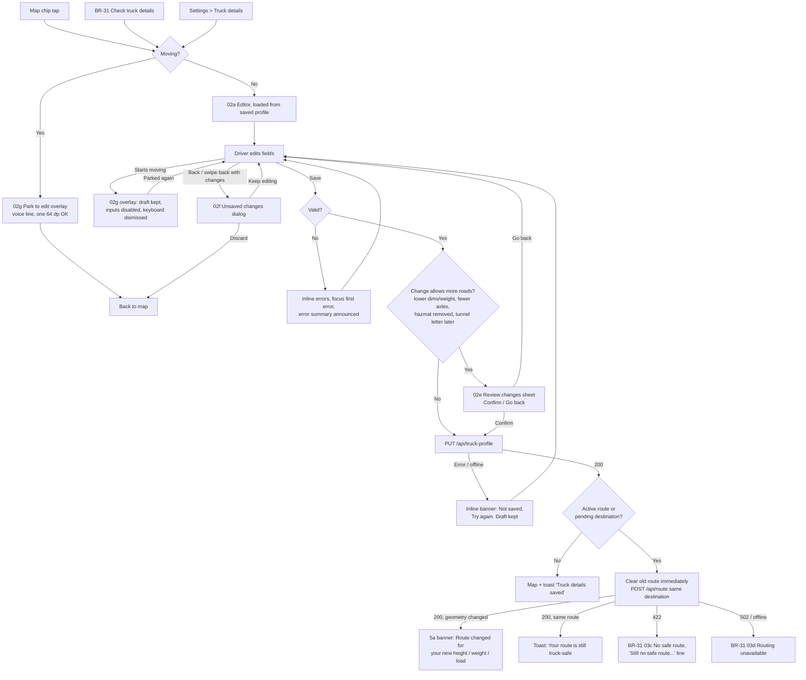

# BR-29 · UC-02 "Edit truck profile": screen spec

| | |
|---|---|
| Jira | BR-29 (UC-02, including alternate flow 5a) |
| Sprint | 2026-11-09 |
| Owner | truckbeez-uiux-designer |
| Implements | truckbeez-fullstack-engineer (mobile Expo RN + API profile contract + server hazmat mapping) |
| Tests | truckbeez-qa-automation-engineer |
| Figma | 02 Truck profile (redesign: frames 02a–02h in section 11), 03 Map (profile chip) |
| Related | BR-31 (no safe route, whose "Check truck details" opens this screen), BR-49 tokens |

Note: `/home/claude/handoff/uiux/ref/` was not present. The "today" behaviour below comes from the task brief.

---

## 1. Problems with today's screen

| Today | Problem | Fix in this spec |
|---|---|---|
| cm / kg only | US drivers think in ft/in and lb. Converting in their head causes errors on the field that protects them from bridge strikes | ft/in + lb by default, metric stored, rounding shown |
| Six HERE switches (flammable, explosive, gas, corrosive, poison, radioactive) | Drivers know the **UN class/division on the placard and shipping papers**, not HERE categories. No PIH, no 2.1/2.2/2.3, no class 9, no combustible, no harmful-to-water | UN class 1–9 with division, PIH toggle, placard chip, and the routing effect shown |
| No tunnel category | HERE `tunnelCategory` B–E isn't used, so tunnel restrictions are applied only by goods type | Tunnel category picker with plain-language help |
| Save is disabled when a field ≤ 0, with no explanation | Silent failure. Screen-reader users get no reason | Save is always enabled. Errors appear inline on save and focus moves to the first error |
| No movement lock | Typing while moving | Editing is blocked above the moving threshold |

---

## 2. Job to be done and context

> "Before I roll, make sure the app routes for *this* truck and *this* load: the height on my sticker, the weight on my scale ticket, the placards on my trailer. Tell me if my change moved my route."

- **Context: parked / pre-trip only.** Editing is never possible while moving (section 7).
- Entry points: (a) the map profile chip; (b) BR-31 "Check truck details"; (c) Settings → Truck details; (d) first run (empty profile).

---

## 3. User flow



**Why the old route is cleared before the re-request:** the old route was validated only for the *old* profile. If the driver raised the height or added hazmat, the old line may now be unsafe. It must not stay on screen as a fallback, even for a second.

---

## 4. Screen 02a: Truck details editor (parked)

### 4.1 Wireframe (portrait 360 × 780 dp, scrolling form, sticky footer)

```
+---------------------------------------------+
| [<- Back 48dp]   Truck details              |  <- 22 sp header
+---------------------------------------------+
| Units   [ ft / lb  |  m / kg ]              |  <- segmented control, 48 dp
|---------------------------------------------|
| SIZE                                         |
| Height *                                     |
| [ 13 ] ft  [ 6  ] in       [13'6"] [14'0"]  |  <- 2 numeric fields 64 dp + preset chips 48 dp
| Saved as 412 cm. We round up, never down.   |  <- live helper, 16 sp
|                                             |
| Width *                                      |
| [ 8  ] ft  [ 6  ] in       [8'6"]           |
| Saved as 260 cm (rounded up)                |
|                                             |
| Length (tractor + trailer) *                 |
| [ 72 ] ft  [ 0  ] in                        |
| Saved as 2,195 cm (rounded up)              |
|---------------------------------------------|
| WEIGHT                                       |
| Gross weight *                [80,000 lb]   |
| [ 80,000        ] lb                        |
| Saved as 36,288 kg (rounded up)             |
|                                             |
| Axles *      [ - ]   5   [ + ]              |  <- stepper, 64 dp buttons
|---------------------------------------------|
| HAZMAT                                       |
| Carrying hazmat?            [  OFF | ON  ]  |  <- switch, 64 dp row
|   (expanded when ON: section 5)             |
|---------------------------------------------|
| Routing will use: 13'6" · 80,000 lb ·       |  <- summary, same formatter as map chip
| 5 axles · No hazmat                         |
+=============================================+
| [            Save truck details          ]  |  <- sticky, 64 dp, always enabled
+---------------------------------------------+
```

`*` = required. The asterisk is decorative. The accessible label says "required".

### 4.2 Units and rounding rule (shown to the driver)

- The **Units** toggle changes display and entry only. Stored values are always **metric integers** (cm, kg).
- **Rounding rule: the truck's own numbers are rounded UP when stored. Limits shown to the driver (bridges, weight limits in BR-31) are rounded DOWN.** Both directions are the safe side.
- Conversion: `cm = ceil(totalInches × 2.54)`, `kg = ceil(lb × 0.45359237)`. In metric mode, decimal cm/kg input is also `ceil`'d.
- The live helper under each field shows the stored value: "Saved as 412 cm. We round up, never down." On the first dimension only, a (i) 48 dp help button opens: "We save your size in centimeters and round up, so a 13 ft 6 in truck is saved as 412 cm (13 ft 6.2 in). That way we never route you under a bridge that's too close."
- **No drift on round trip:** the client also stores the driver's entered value and unit (`*Entered` fields, section 9) and always redisplays what the driver typed. If there's no entered value in the current unit system (entered in metric, viewed in ft), display = the stored metric converted and **rounded up** to the next whole inch / lb.
- Inches accept 0–11.9 (one decimal). If the driver types `12` or more in the inches field, show an inline error ("Inches must be 0 to 11.9"). Don't silently carry over to feet.
- Weight uses grouping (`80,000`) on blur. Entry accepts digits only (numeric keypad, `keyboardType="number-pad"`).

### 4.3 Presets
Preset chips fill common values in one tap, with fewer typing errors: Height `13'6"`, `14'0"`. Width `8'6"`. Weight `80,000 lb`. Metric mode: `4.1 m`, `4.3 m`, `2.6 m`, `40,000 kg`. A preset chip is a 48 dp target with the label "Set height to 13 feet 6 inches".

### 4.4 Validation

| Field | Hard limit (blocks save) | Soft warning (doesn't block; shown inline, amber `status.caution` + icon) |
|---|---|---|
| Height | 6 ft – 16 ft (183–488 cm) | > 14 ft 6 in: "That's taller than most US roads allow. Double-check your height." < 10 ft: "That's low for a tractor-trailer. Double-check." |
| Width | 6 ft – 10 ft (183–305 cm) | > 8 ft 6 in: "Over 8 ft 6 in is oversize. You may need a permit." |
| Length | 10 ft – 120 ft (305–3,658 cm) | > 75 ft: "That's long. Check that this includes tractor and trailer." |
| Gross weight | 5,000 – 200,000 lb (2,268–90,719 kg) | > 80,000 lb: "Over 80,000 lb usually needs an overweight permit." |
| Axles | integer 2–12 | none |
| Hazmat | if ON, ≥ 1 class selected; classes 1, 2, 4, 5, 6 need ≥ 1 division | none |
| Tunnel category | optional (section 6) | if hazmat ON and "Not sure": info line (section 6) |

Error copy (inline under the field, with an error icon, never colour only):
- Empty: "Enter your {field}." / "Introduzca {campo}."
- Out of range: "Enter a height between 6 ft and 16 ft."
- Hazmat with no class: "Pick at least one hazmat class, or turn hazmat off."
- Class with no division: "Pick which Class 2 gas you're carrying."

Timing: validate on blur and on Save. **Save is always enabled.** On an invalid Save: scroll to the first error, move focus to it, and announce "2 problems. Height: enter a height between 6 ft and 16 ft…".

---

## 5. Hazmat section (02c / 02d)

### 5.1 Wireframe (hazmat ON)

```
| HAZMAT                                       |
| Carrying hazmat?                 [ ON ]     |
| Pick every class on your placards or papers |
|                                             |
| [<1>      ] [<2>      ] [<3>      ]         |  <- class tiles 3x3, 96 x 80 dp each
|  Explosive   Gas         Flammable          |     diamond icon + number + name
|                          liquid             |     selected: 3 dp border + check icon
| [<4>      ] [<5>      ] [<6>      ]         |
|  Flammable   Oxidizer /  Toxic /            |
|  solid       peroxide    infectious         |
| [<7>      ] [<8>      ] [<9>      ]         |
|  Radioactive Corrosive   Misc.              |
|                                             |
| Class 2: which gas?          (expanded)     |  <- division chips, 48 dp
|  [2.1 Flammable gas] [2.2 Non-flammable]    |
|  [2.3 Toxic gas - inhalation hazard]        |
|                                             |
| Class 6: which?                             |
|  [6.1 Toxic] [6.2 Infectious]               |
|  Poison inhalation hazard (PIH)?   [OFF]    |  <- only when 6.1 selected, 64 dp row
|  Papers say "Inhalation Hazard" or Zone A/B |
|                                             |
| More (not a class placard):                 |
|  Combustible liquid (US)            [OFF]   |
|  Marine pollutant / env. hazardous  [OFF]   |
|                                             |
| Placards: [ 2.1 ][ 3 ][ 6.1 PIH ]           |  <- placard summary chip row
| Routing avoids roads and tunnels closed to: |
|   flammable · gas · poison · inhalation     |
|   hazard                                    |
|                                             |
| TUNNEL CATEGORY (section 6)                 |
```

- **Class tiles** carry the number + name + diamond outline. Don't reproduce the full DOT placard colours as the only cue (red/white for 3, etc.). The diamond can use the placard colour as the tile accent, but the number and text carry the meaning.
- Divisions are required for classes 1 (1.1–1.6), 2 (2.1/2.2/2.3), 4 (4.1/4.2/4.3), 5 (5.1/5.2) and 6 (6.1/6.2). Classes 3, 7, 8 and 9 have no division picker.
- **2.3 is always an inhalation hazard.** When 2.3 is selected, show a non-interactive line "Inhalation hazard: included with 2.3". There is no toggle to turn it off.
- **PIH toggle** is shown only when 6.1 is selected. Turning off 6.1 clears PIH.
- Turning hazmat OFF keeps the selections in the draft until save (so an accidental toggle can be undone). On save with hazmat OFF, the classes are cleared. Removing hazmat triggers the review sheet (section 8.2).

### 5.2 Class → routing mapping (shown to the driver; server is the source of truth)

The UI **must not hard-code a different mapping from the server.** Put the table below in a shared package (`packages/hazmat`, consumed by app + API) or serve it from `GET /api/hazmat/mapping`. The "Routing avoids…" line is generated from that table. The server mapping in PR #10 wins wherever it differs. Full-stack: please confirm or correct each row. The proposals below are conservative.

| UI choice | HERE `shippedHazardousGoods` (proposed) | Driver-facing "avoids roads and tunnels closed to…" |
|---|---|---|
| 1.1–1.6 Explosive | `explosive` | explosives |
| 2.1 Flammable gas | `gas`, `flammable` | gas · flammable loads |
| 2.2 Non-flammable gas | `gas` | gas |
| 2.3 Toxic gas | `gas`, `poison`, `poisonousInhalation` | gas · poison · inhalation hazard |
| 3 Flammable liquid | `flammable` | flammable loads |
| 4.1 / 4.2 / 4.3 | `flammable` | flammable loads |
| 5.1 Oxidizer | `other` (+ `flammable`, conservative; confirm) | oxidizers (other hazmat) |
| 5.2 Organic peroxide | `organic`, `flammable` (confirm) | organic peroxides · flammable loads |
| 6.1 Toxic | `poison` | poison |
| 6.1 + PIH | `poison`, `poisonousInhalation` | poison · inhalation hazard |
| 6.2 Infectious | `other` | other hazmat |
| 7 Radioactive | `radioactive` | radioactive loads |
| 8 Corrosive | `corrosive` | corrosive loads |
| 9 Miscellaneous | `other` | other hazmat |
| Combustible liquid (US) | `combustible` | combustible loads |
| Marine pollutant / env. hazardous | `harmfulToWater` | water-protection areas |

### 5.3 Placard summary chip
- Shows each selected division in UN number order: `1.1` … `9`, then `PIH` folded into its class (`6.1 PIH`). 2.3 shows as `2.3` (it is always inhalation).
- Combustible shows as `Combustible`. Marine pollutant shows as `Marine pollutant`.
- Purpose: a glance check against the placards on the trailer. The help text says: "Check this matches the placards on your truck."
- Read-only, with an accessibility label like "Placards: 2.1, 3, 6.1 with poison inhalation hazard".

---

## 6. Tunnel category (02d)

Shown only when hazmat is ON. A single-choice list. Each option is a 64 dp row with a radio button.

| Option | Plain-language help | Stored |
|---|---|---|
| **B**: most limited | Avoids almost all tunnels that have hazmat rules (B, C, D and E tunnels). | `"B"` |
| **C** | Avoids C, D and E tunnels. | `"C"` |
| **D** | Avoids D and E tunnels. | `"D"` |
| **E**: least limited | Avoids only E tunnels. | `"E"` |
| **Not sure** (default) | We'll use the strictest setting (B). Some routes may be longer. | `null`, source `notSure` |

Help (i) text: "The tunnel code is on your shipping papers, in brackets after the hazmat description, for example (C/D). If you see two letters, pick the **first** one, because it's the stricter one for your truck. These codes are used mostly in Europe and in some tunnels elsewhere. If your papers don't show one, choose Not sure."

The letter order is counter-intuitive (B is the most restrictive *for the vehicle*). The labels "most limited" / "least limited" are therefore mandatory. Don't show letters alone.

**Proposed server behaviour for "Not sure" + hazmat ON:** send `tunnelCategory=B` (conservative, per "hazmat correctness beats route speed"). This is an open question in the README, because it may raise the 422 rate. If confirmed, the BR-31 copy covers the case through the `tunnel` reason row.

---

## 7. Editing blocked while moving (02g)

Uses the motion hook shared with BR-31: moving = > 8 km/h for 3 s, parked = < 3 km/h for 5 s, no GPS fix = moving.

| Situation | Behaviour |
|---|---|
| Entry attempt while moving (chip tap, settings) | The editor doesn't open. Show the 02g overlay: title "Park to change truck details", sub "Your current details: 13'6" · 80,000 lb · Hazmat 3", one **OK** button (72 dp). Voice: "You can change truck details when you're parked." |
| Starts moving while editing | Dismiss the keyboard and disable all inputs. 02g overlay over the form: "Editing paused while you drive. Your changes are kept." One **OK** button returns to the map. **The draft is kept** (in memory + AsyncStorage, 12 h) and **never auto-saved**. Unconfirmed safety data must not change routing. |
| Parks again with a draft | Reopening the editor restores the draft and shows the banner "You have unsaved changes from earlier." with **Review** / **Discard** buttons. |
| Voice "change my height" while moving | The copilot replies with the same line as above. No voice editing of profile in Phase 1 (hand-off note for the AI architect). |

---

## 8. Dialogs, review and save results

### 8.1 Unsaved changes (02f)
Trigger: Back, hardware back or swipe-back with a dirty form.
- Title: "Leave without saving?"
- Body: "Your truck details won't change. Routes will still use: {old profile chip}."
- Actions (stacked, 64 dp): **Keep editing** (primary, default focus) · **Discard changes** (destructive style, plus icon).

### 8.2 Review changes that allow more roads (02e)
Shown on Save when any change *loosens* routing: lower height/width/length/weight, fewer axles, hazmat removed, a class removed, PIH off, or the tunnel letter moved toward E. Tightening changes save directly. They're already the safe direction.

```
Check these changes
These let routes use more roads:
  Height  13'6"  ->  12'6"
  Hazmat  3      ->  none
Only confirm if this matches your truck right now.
[ Confirm and save ]  (primary, 64 dp)
[ Go back ]          (secondary, 64 dp)
```
Removing hazmat adds this line: "Only remove hazmat if your truck is empty and the placards are off."

### 8.3 Save results

| Result | UI |
|---|---|
| 200, no active route | Back to map. Toast "Truck details saved" (4 s, `accessibilityLiveRegion="polite"`). The chip updates. |
| 200, active route → new route differs (alternate flow **5a**) | Map with the new route drawn + top banner (8 s, also dismissible): **"Route changed for your new {height \| weight \| length \| load}"**, sub "+12 min · avoids I-95 tunnel". Several changed → "for your new truck details". "load" = any hazmat or tunnel change. |
| 200, active route → same geometry | Toast "Your route is still truck-safe." |
| 200 → route 422 | BR-31 03c with the "Still no safe route with your updated details." line |
| 200 → route 502 / offline | BR-31 03d / offline. The new profile **is** saved. Text: "Truck details saved. Routing is down, so we can't check your route yet." |
| PUT fails / offline | Stay in the editor. Inline banner at the top: "Not saved. Check your connection and try again." Draft kept. The old profile still applies. Never apply a profile locally that the server hasn't accepted, because the server routes with its copy. |

5a strings: `profile.routeChanged.height` "Route changed for your new height" / "Ruta cambiada por su nueva altura". `.weight` "…new weight" / "…nuevo peso". `.length` "…new length" / "…nuevo largo". `.load` "…new load" / "…nueva carga". `.multiple` "…new truck details" / "…nuevos datos del camión".

The 5a delta (minutes, the avoided feature) comes from comparing old and new `durationS`. "avoids {feature}" appears only if the server provides it. Otherwise only the time delta is shown.

---

## 9. Map profile chip (03 Map, 04 Navigating)

```
[ 13'6" · 80,000 lb · <◇> Hazmat 3 ]
```

| Rule | Spec |
|---|---|
| Format | `{height} · {weight}` + ` · Hazmat {firstDivision}` + ` +{n}` if more than one |
| Hazmat priority for `firstDivision` | 1.x > 2.3 > 6.1 PIH > 7 > 2.1 > 3 > 4.x > 5.x > 8 > 6.1 > 2.2 > 6.2 > 9 > Combustible > Marine pollutant |
| Examples | `13'6" · 80,000 lb` · `13'6" · 80,000 lb · Hazmat 3` · `13'6" · 80,000 lb · Hazmat 2.3 +2` · metric `4.12 m · 36.3 t · Hazmat 3` |
| Icon | Hazmat diamond icon when hazmat is ON. The icon is also present, so it's never colour only. |
| Size / position | Min height 48 dp, top-right below the compass. It must not overlap the next-maneuver, speed-limit or lane-guidance areas. In 04 Navigating it shrinks to `13'6" · Hazmat 3` (weight dropped) if the width is under 160 dp. |
| Tap (parked) | Opens the editor |
| Tap (moving) | 02g overlay (section 7). Not disabled-looking, so the driver isn't confused. |
| Empty profile | Chip in caution style: "Set truck details". Route requests are blocked until set ("Add your truck details to get a truck-safe route"). There are no defaults: a default height would be a guess. |
| a11y label | "Truck details: 13 feet 6 inches, 80,000 pounds, hazmat class 3. Button. Double-tap to edit." |
| Formatter | Single shared function `formatProfileChip(profile, unitSystem, {compact})`, reused by BR-31 "Checked for" and the editor summary |

---

## 10. Data contract (hand-off to truckbeez-fullstack-engineer)

`GET /api/truck-profile` / `PUT /api/truck-profile` (JSON). The server validates with the same rules and returns `400 {code:"INVALID_PROFILE", fields:{<field>: "<errorKey>"}}`. The client maps the `errorKey` to copy.

| Field | Type | Unit stored | Validation | Notes |
|---|---|---|---|---|
| `version` | integer | n/a | required on PUT, must match | Optimistic concurrency. A 409 means it was changed on another device / by the fleet. Reload and show "Your truck details were updated elsewhere." |
| `unitSystem` | `"imperial" \| "metric"` | n/a | enum | Display preference only |
| `heightCm` | integer | cm | 183–488 | `ceil(in × 2.54)` |
| `heightEntered` | `{value:number, unit:"in"\|"cm"}` \| null | as entered | value > 0. Inches total, 1 decimal | Redisplay only. **Never used for routing** |
| `widthCm` | integer | cm | 183–305 | |
| `widthEntered` | as above | | | |
| `lengthCm` | integer | cm | 305–3658 | Overall length, tractor + trailer(s) |
| `lengthEntered` | as above | | | |
| `grossWeightKg` | integer | kg | 2268–90719 | `ceil(lb × 0.45359237)` |
| `grossWeightEntered` | `{value:number, unit:"lb"\|"kg"}` \| null | as entered | | |
| `axleCount` | integer | count | 2–12 | |
| `hazmat.enabled` | boolean | n/a | | |
| `hazmat.divisions` | string[] | n/a | unique. Each in `["1.1","1.2","1.3","1.4","1.5","1.6","2.1","2.2","2.3","3","4.1","4.2","4.3","5.1","5.2","6.1","6.2","7","8","9"]`. Non-empty if `enabled` and neither flag below is set. Empty if not `enabled` | |
| `hazmat.pih` | boolean | n/a | `true` only allowed if `"6.1"` is in divisions | 2.3 implies inhalation server-side. No flag needed |
| `hazmat.combustibleLiquid` | boolean | n/a | false if not `enabled` | → `combustible` |
| `hazmat.environmentallyHazardous` | boolean | n/a | false if not `enabled` | → `harmfulToWater` |
| `hazmat.tunnelCategory` | `"B" \| "C" \| "D" \| "E" \| null` | n/a | null if not `enabled` | null + enabled → server sends `B` (pending decision) |
| `hazmat.tunnelCategorySource` | `"driver" \| "notSure"` \| null | n/a | | For analytics and support |
| `derived.shippedHazardousGoods` | string[] (read-only, response only) | n/a | | The server's mapping result. The UI uses it for the "Routing avoids…" line after save, to confirm what the server will send |
| `derived.tunnelCategoryApplied` | `"B".."E"` \| null (read-only) | | | |
| `updatedAt` | ISO 8601 | UTC | server-set | |

**Migration from today's six switches:** flammable → `3`, explosive → `1.1`, gas → `2.2` with `tunnelCategorySource:"notSure"`, corrosive → `8`, poison → `6.1`, radioactive → `7`. The gas and poison migrations are under-specified: on the first open after the upgrade, show the banner "Check your hazmat classes. We updated how hazmat is set." until the driver saves. Until then, the server should route migrated gas as `gas`+`flammable`+`poisonousInhalation` and poison as `poison`+`poisonousInhalation` (most conservative). Full-stack to confirm.

---

## 11. Figma frames
02a editor (day/night) · 02b validation errors · 02c hazmat ON, classes · 02d divisions + PIH + tunnel · 02e review changes · 02f unsaved changes · 02g park to edit · 02h 200% font / es-US. 03 Map: chip variants (none / hazmat / +n / empty / compact). 03 Map: 5a banner.

---

## 12. Tokens (additions; reuse BR-31 additions for status colours and targets)

```json
{
  "size": {
    "field": { "minHeight": 64, "inchesWidth": 88, "feetWidth": 88 },
    "hazmatTile": { "width": 96, "height": 80, "selectedBorder": 3 },
    "chip": { "minHeight": 48, "compactBreakpoint": 160 },
    "stepperButton": 64
  },
  "type": {
    "form": {
      "section": { "size": 14, "weight": "700", "letterSpacing": 1, "transform": "uppercase" },
      "label":   { "size": 18, "weight": "600" },
      "input":   { "size": 24, "weight": "600" },
      "helper":  { "size": 16, "weight": "400" },
      "error":   { "size": 16, "weight": "600" }
    },
    "chip": { "size": 16, "weight": "700" }
  },
  "profile": {
    "limits": {
      "heightCm": [183, 488], "widthCm": [183, 305], "lengthCm": [305, 3658],
      "grossWeightKg": [2268, 90719], "axleCount": [2, 12]
    },
    "softWarn": { "heightCmAbove": 442, "heightCmBelow": 305, "widthCmAbove": 260, "lengthCmAbove": 2286, "grossWeightKgAbove": 36288 },
    "draftTtlHours": 12
  }
}
```

Helper text uses `color.text.*.secondary` (AAA per BR-31). Error text uses `color.status.blocked.*` (≥ 7:1) **plus** an error icon. Soft warnings use `color.status.caution.*` plus a caution icon.

---

## 13. Accessibility and localization

- **Labels:** every input has a visible label and an accessible label that includes the unit and required state: "Height, feet, required" / "Height, inches". The helper and error are linked (`accessibilityHint` / `aria-describedby` equivalent), so the stored value and the error are read after the label.
- **Units spoken in words** ("13 feet 6 inches", "80,000 pounds"), never `'`, `"` or `lb`.
- **Class tiles** have role `checkbox`, state checked/unchecked, label "Class 3, flammable liquid". Division chips are `checkbox` too. The tunnel options are a `radiogroup`.
- **Switches** have role `switch` and label "Carrying hazmat". The PIH label is "Poison inhalation hazard".
- **Errors:** on an invalid Save, announce the summary (assertive), then focus the first invalid field.
- **Font scale 200%:** the form scrolls. Class tiles reflow to 2 columns at ≥ 1.5×, and 1 column at 2.0×. The Save footer stays sticky. Inch/foot fields stack vertically at ≥ 1.5×.
- **Keyboard:** numeric keypads. The return key moves to the next field. Save is reachable by the hardware keyboard / switch control.
- **Night theme:** form surfaces `surface.night.base/raised`. No white fields: input backgrounds `#1C1F24` with a 2 dp `#9CA3AF` border (≥ 3:1 against the base).
- **es-US:** "Datos del camión", "Altura", "Ancho", "Largo", "Peso bruto", "Ejes", "¿Lleva materiales peligrosos?", "Clase", "Peligro por inhalación (PIH)", "Categoría de túnel", "Guardar datos del camión". Units stay ft/in/lb in es-US (US regulation), with metric available. Needs native review.

### 13.1 `testID`s

| testID | Element |
|---|---|
| `truckProfile.screen` | Editor root |
| `truckProfile.units` / `.units.imperial` / `.units.metric` | Units toggle |
| `truckProfile.height.ft` / `.height.in` / `.height.cm` | Height inputs (cm only in metric) |
| `truckProfile.height.stored` | "Saved as … cm" helper |
| `truckProfile.height.error` / `.height.warning` | Inline error / soft warning |
| `truckProfile.height.preset.{value}` | e.g. `truckProfile.height.preset.13-6` |
| `truckProfile.width.*`, `truckProfile.length.*` | Same pattern |
| `truckProfile.weight.lb` / `.weight.kg` / `.weight.stored` / `.weight.error` / `.weight.warning` | Weight |
| `truckProfile.axles.value` / `.axles.decrement` / `.axles.increment` | Stepper |
| `truckProfile.hazmat.toggle` | Hazmat switch |
| `truckProfile.hazmat.class.{1-9}` | Class tiles |
| `truckProfile.hazmat.division.{1.1…6.2}` | Division chips (the dot is kept: `truckProfile.hazmat.division.2.3`) |
| `truckProfile.hazmat.pih` | PIH switch |
| `truckProfile.hazmat.combustible` / `.hazmat.envHazard` | Extra switches |
| `truckProfile.hazmat.placards` | Placard chip row |
| `truckProfile.hazmat.avoids` | "Routing avoids…" text |
| `truckProfile.hazmat.error` | Hazmat error |
| `truckProfile.tunnel.{B,C,D,E,notSure}` | Tunnel options |
| `truckProfile.summary` | "Routing will use…" |
| `truckProfile.save` | Save |
| `truckProfile.saveError` | PUT failure banner |
| `truckProfile.draftBanner` / `.draftBanner.review` / `.draftBanner.discard` | Restored-draft banner |
| `truckProfile.review` / `.review.confirm` / `.review.back` | Review changes sheet |
| `truckProfile.unsaved` / `.unsaved.keep` / `.unsaved.discard` | Unsaved dialog |
| `truckProfile.movingLock` / `.movingLock.ok` | Park-to-edit overlay |
| `map.profileChip` | Map chip |
| `map.routeChangedBanner` | 5a banner |
| `toast.profileSaved` / `toast.routeStillSafe` | Toasts |

---

## 14. Acceptance criteria (automatable)

**Units and rounding**
- AC-1 Enter 13 ft 6 in → `truckProfile.height.stored` reads "Saved as 412 cm". The PUT body has `heightCm: 412` and `heightEntered: {value:162, unit:"in"}`.
- AC-2 Enter 80000 lb → `grossWeightKg: 36288`. Enter 8 ft 6 in width → `widthCm: 260`.
- AC-3 Reopen the editor after saving → the fields show 13 / 6 (the entered value, no drift to 13'7").
- AC-4 Switch units to metric → the height field shows 412 (cm). The stored value is unchanged without a save.
- AC-5 Enter 12 in the inches field → `truckProfile.height.error` "Inches must be 0 to 11.9". The feet value is unchanged.

**Validation**
- AC-6 Height 17 ft → error, save blocked, focus lands on `truckProfile.height.ft`, and a screen-reader announcement contains "Height".
- AC-7 Height 14 ft 9 in → `truckProfile.height.warning` is shown, and save succeeds.
- AC-8 `truckProfile.save` is enabled in every state, including an empty form.
- AC-9 Hazmat ON with no class → `truckProfile.hazmat.error`. Class 2 with no division → the division error.

**Hazmat**
- AC-10 Select 2.3 → `truckProfile.hazmat.pih` doesn't exist, the "Inhalation hazard: included" text is shown, and `truckProfile.hazmat.avoids` contains "inhalation hazard".
- AC-11 `truckProfile.hazmat.pih` exists only when `division.6.1` is checked. Unchecking 6.1 sets `pih:false` in the PUT.
- AC-12 Select 3 + 6.1 + PIH → `truckProfile.hazmat.placards` text is "3 · 6.1 PIH". After save, the response's `derived.shippedHazardousGoods` ⊇ `["flammable","poison","poisonousInhalation"]`.
- AC-13 The "Routing avoids" text for each row of the 5.2 table matches the shared mapping fixture (data-driven test over every division).
- AC-14 Tunnel options are visible only with hazmat ON. The default is `notSure`. Choosing `C` → `tunnelCategory:"C"`, `tunnelCategorySource:"driver"`.

**Flows**
- AC-15 Dirty form + back → `truckProfile.unsaved`. "Keep editing" keeps the values. "Discard" → map with an unchanged chip.
- AC-16 Lower the height or turn hazmat OFF → Save shows `truckProfile.review`. Raise the height → no review, saved directly.
- AC-17 With an active route, raise the height and save → `map.routeLine` is removed before the new `POST /api/route` resolves (assert in order: removed → request → drawn). A changed geometry fixture → `map.routeChangedBanner` text "Route changed for your new height".
- AC-18 Same geometry fixture → `toast.routeStillSafe`. A 422 fixture → `routeError.sheet` (BR-31) with the "Still no safe route" line.
- AC-19 PUT 500/offline → `truckProfile.saveError` is visible, the fields are kept, and the chip shows the old values.
- AC-20 Mock speed 60 km/h, tap `map.profileChip` → `truckProfile.movingLock` is visible and `truckProfile.screen` isn't. The TTS event fires.
- AC-21 In the editor with edits, mock speed 60 km/h for 3 s → the keyboard is dismissed, all inputs report `enabled=false`, `truckProfile.movingLock` is shown, and no PUT is sent. Park for 5 s and reopen → `truckProfile.draftBanner` with the earlier values.
- AC-22 The chip text for fixture profiles matches the section 9 examples exactly (imperial, metric, +n, compact, empty).
- AC-23 Empty profile → the chip reads "Set truck details", and a route request isn't sent.
- AC-24 The migration fixture (old `gas:true`) → the editor shows the "Check your hazmat classes" banner.

**Accessibility**
- A11Y-1 All inputs, steppers, toggles, tunnel rows, Save and the dialog buttons have height ≥ 64 dp. Preset chips, division chips, Back and the help (i) are ≥ 48 × 48 dp. Spacing ≥ 8 dp.
- A11Y-2 Every input has a non-empty accessible label containing its visible label and unit word. Required fields contain "required".
- A11Y-3 The class tiles and division chips expose role checkbox + checked state. The tunnel options expose radio + selected.
- A11Y-4 Contrast: labels, input text, errors and the chip ≥ 7:1. Helpers ≥ 4.5:1. Borders and icons ≥ 3:1, in both themes.
- A11Y-5 Errors and warnings each have an icon element next to them (not colour only). Grayscale snapshot diff: error vs normal state are distinguishable.
- A11Y-6 At font scale 2.0, no clipped text and Save stays visible.
- A11Y-7 es-US: no missing keys. The class tile labels don't truncate at 1.0× scale.

---

## 15. Usability checklist

| Area | Check | Status |
|---|---|---|
| Safety | No editing while moving. The draft is never auto-saved. Loosening changes need confirmation. The old route is cleared on profile change | Spec'd |
| Hazmat correctness | Division-level input, PIH, conservative defaults for "Not sure" and migration, the server mapping is the single source | Spec'd. Mapping rows to be confirmed |
| Glanceability | Chip readable in < 2 s. The placard chip mirrors the trailer | Spec'd |
| A11y | Targets, labels with units, roles, error focus, font scale | Spec'd |
| Localization | es-US strings, number grouping, units stay imperial in the US | Needs native review |
| Edge | Inches ≥ 12, metric↔imperial drift, 409 conflict, offline save, empty profile, migration | Spec'd |

## 16. Hand-off
- **truckbeez-fullstack-engineer:** editor UI, `formatProfileChip`, conversion helpers (`toStoredCm`, `toStoredKg`, `formatTruckDim` rounding up, `formatLimitDim` rounding down), the shared hazmat mapping package, the PUT contract + server validation + `derived` fields, the migration, and the motion hook shared with BR-31.
- **truckbeez-qa-automation-engineer:** the AC/A11Y list. Data-driven tests over the mapping table and the rounding cases (13'6", 14'0", 8'6", 80,000 lb, 0.1 in edge).
- **truckbeez-ai-agent-architect:** the moving-lock voice line. Confirm that no voice-driven profile editing ships in Phase 1.
- **truckbeez-security-engineer:** the profile is linked to a driver and its hazmat history may reveal cargo. Confirm retention and fleet visibility for `hazmat.*` change history.
