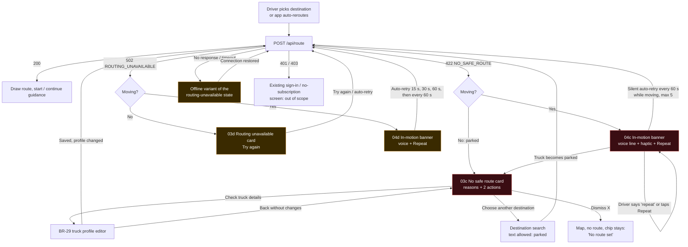

# BR-31 · UC-04 "No truck-safe route available": screen spec

| | |
|---|---|
| Jira | BR-31 (UC-04) |
| Sprint | 2026-11-09 |
| Owner | truckbeez-uiux-designer |
| Implements | truckbeez-fullstack-engineer (mobile, Expo RN) |
| Tests | truckbeez-qa-automation-engineer (Appium + axe/a11y checks) |
| Voice lines | coordinate with truckbeez-ai-agent-architect (voice copilot) |
| Figma | 03 Map, 04 Navigating (new frames needed: 03c, 03d, 04c, 04d, listed in section 9) |
| Depends on | PR #10 `POST /api/route` behaviour; BR-29 truck profile editor (the "Check truck details" target) |

Note: `/home/claude/handoff/uiux/ref/` was not present. This spec is written from the API and screen descriptions in the task brief. Component names are proposals. If the code on the branch uses other names, keep the code's names and the `testID`s below.

---

## 1. Job to be done and context

> "When the app can't find a road my truck can legally use, tell me straight away, in words I understand, what's blocking me, and give me one obvious next step. Never hand me a car route or a guess."

| Context | Trigger | What the driver can do |
|---|---|---|
| **Pre-trip / parked** (speed below the parked threshold) | Route request for a new destination returns 422 | Read the reasons, tap **Check truck details** or **Choose another destination** |
| **In motion** (speed above the moving threshold) | Automatic reroute (off-route or a new report) returns 422 | Listen to the voice line. One large **Repeat** action. No reading needed. |
| **Any** | 502 `ROUTING_UNAVAILABLE` | **Try again** (the app also retries on its own). Never a car route. |
| **Any** | No network / timeout (no HTTP response) | Same layout as 502 with "No connection" copy |

**Motion thresholds** (shared with BR-29, with hysteresis so the UI doesn't flicker):
- *Moving*: GPS speed > 8 km/h (5 mph) for 3 s, matching the "text input locked above walking speed" rule.
- *Parked*: speed < 3 km/h for 5 s.
- If there's no GPS fix, treat the truck as **moving** (fail safe).

---

## 2. User flow



**Rules on every error path**
1. The drawn route is cleared (this is what PR #10 already does). No stale line, no car route, no straight line to the destination.
2. The destination is **kept** in state, so "Try again" and a re-request after a profile change go to the same place without the driver typing it again.
3. Previously announced restriction markers (low clearance, weigh station) near the truck stay on the map. They are facts about the road, not the route.

---

## 3. Screen 03c: No safe route (parked)

### 3.1 Wireframe (portrait, 360 × 780 dp reference)

```
+--------------------------------------------+
| [map, dimmed 40%, truck puck, dest pin]     |
|                                             |
|                                 [Profile    |
|                                  chip]      |  <- BR-29 chip, still visible
+=============================================+  <- bottom sheet, fixed height (not draggable)
| [!octagon]  No truck-safe route             |  <- title, 28 sp bold, AAA
|             to Walmart DC, Bentonville      |  <- 18 sp, destination name, 1 line, ellipsize
|---------------------------------------------|
| Why:                                        |  <- 16 sp label
| [bridge] Low bridge: 12 ft 4 in             |  <- reason row, 20 sp, icon 32 dp
|          Your truck: 13 ft 6 in             |  <- 18 sp secondary, AAA
| [hazmat] Hazmat 3 not allowed on            |
|          the only access road               |
|          (max 3 rows, then "+2 more")       |
|---------------------------------------------|
| Checked for: 13'6" · 80,000 lb · Hazmat 3   |  <- profile summary, 16 sp
|---------------------------------------------|
| [  Check truck details               ]      |  <- primary, full width, 64 dp
| [  Choose another destination        ]      |  <- secondary (outlined), full width, 64 dp
|                                             |
| We never send a truck on a route it can't   |  <- 16 sp reassurance, 1-2 lines
| use. Not sure? Call your dispatcher.        |
+---------------------------------------------+
  [X close] 48 dp in the sheet's top-right corner
```

**Hierarchy, top to bottom:** (1) the state, "No truck-safe route"; (2) why; (3) what the app checked; (4) the two actions; (5) reassurance.

**Why both actions are full-width at 64 dp even when parked:** the driver may be in a cab with gloves on and the phone still in its mount. The ≥ 48 dp parked minimum is a floor, not the goal, for primary decisions.

**Order of actions:** "Check truck details" comes first. The most common cause in testing is a profile value that's wrong or overly conservative (a typo in height, or hazmat left on after delivery). It's also the only action that can turn a 422 into a 200 for the same destination.

### 3.2 Components

| Component | Notes |
|---|---|
| `RouteErrorSheet` (variant `noSafeRoute`) | Bottom sheet, fixed height, no drag-to-dismiss (prevents accidental dismissal). Night: `color.surface.night.raised`. No large white surfaces. |
| `StatusIcon` `blocked` | Octagon with an exclamation mark, 40 dp, `color.status.blocked.*`. Always paired with the title text: **never colour alone**. |
| `ReasonRow` | Icon (32 dp) + primary line + optional secondary line. One row per *distinct* reason after de-duplication. |
| `ProfileSummary` | Same formatter as the BR-29 map chip (`formatProfileChip`). |
| `Button` primary / secondary | Existing BR-49 button tokens, `size="xl"` (64 dp min height). |
| `IconButton` close | 48 dp, top-right corner. Label "Close". |

### 3.3 States

| State | Display |
|---|---|
| Loading (route request in flight) | Existing "Finding a truck-safe route…" spinner. The sheet isn't shown yet. |
| 422 with ≥ 1 mapped reason | Reasons list as in the wireframe |
| 422 with only generic or unknown reasons | Generic fallback row (section 5.3) |
| 422 with an empty `reasons[]` | Generic fallback row |
| After **Check truck details** → save | The sheet is replaced by the loading state and the route is re-requested automatically for the same destination |
| Retry still returns 422 | Same sheet. Add the line "Still no safe route with your updated details." above the reasons |
| Driver starts moving while the sheet is open | Switch to 04c without animation flash (cross-fade ≤ 200 ms, `motion.duration.short`). Don't play the voice line again if it was played < 60 s ago. |

---

## 4. Screen 04c: No safe route (in motion)

Applies when an **automatic reroute** returns 422 while moving (off-route, a new closure report, or a restriction found ahead). A new manual destination can't be entered while moving: search is voice-only, and a voice destination request that returns 422 also lands here.

### 4.1 Wireframe

```
+---------------------------------------------+
| [=== top banner, full width, 112 dp ======] |
| [!oct 48dp]  No safe route from here        |  <- 28 sp bold, AAA, 1 line
|              Pull over when safe            |  <- 22 sp, AAA, 1 line
+---------------------------------------------+
|                                             |
|        [map, NOT dimmed: truck puck,        |
|         heading-up, restriction markers]    |
|                                             |
|  [speed limit]                 [profile]    |  <- truck speed limit stays visible
|                                             |
| [=========== REPEAT  (speaker icon) ======] |  <- single action, 72 dp tall, full width
+---------------------------------------------+
```

- **One primary action: Repeat** (replays the voice line). No "Check truck details" and no "Choose another destination" while moving. Both need reading or input. They appear automatically when the truck becomes parked (the flow switches to 03c).
- **No reasons list while moving.** The *top* reason is spoken (section 6), not shown as a list.
- The banner stays until a route is found or the driver parks. It can't be swiped away while moving.
- The posted truck speed limit and the upcoming low-clearance / weigh-station markers **stay visible**. The design rule says truck-specific info is always visible, and with no route these markers matter more, not less.
- Silent auto-retry every 60 s while moving (max 5). If a route is found: chime, then "Truck-safe route found. Continue on …" and guidance resumes.

### 4.2 Multimodal pattern (hazmat and restriction warning pattern)

| Channel | Spec |
|---|---|
| Icon | `blocked` octagon, 48 dp |
| Colour | Banner border-left 8 dp `color.status.blocked.*`. The banner fill is the neutral raised surface (no red flood, so it doesn't dazzle at night). |
| Voice | Section 6. Ducks music and other audio, plays once on entry, again on Repeat or the voice command "repeat". |
| Haptic | `haptic.critical`: 3 pulses × 150 ms, 100 ms gap, played once with the voice line. Not repeated on auto-retry. |
| Text | Two lines max, ≤ 32 characters per line in English (Spanish allowance in section 8) |

---

## 5. Copy

Style: plain English, CEFR B1, active voice, no jargon ("restriction" only when nothing else fits). Imperial units by default, metric when the profile unit setting is metric (BR-29).

### 5.1 Core strings

| Key | English | Spanish (needs native review) |
|---|---|---|
| `route.noSafe.title` | No truck-safe route | No hay ruta segura para su camión |
| `route.noSafe.toDest` | to {destinationName} | a {destinationName} |
| `route.noSafe.whyLabel` | Why: | Motivo: |
| `route.noSafe.checkedFor` | Checked for: {profileChip} | Revisado para: {profileChip} |
| `route.noSafe.action.checkTruck` | Check truck details | Revisar datos del camión |
| `route.noSafe.action.otherDest` | Choose another destination | Elegir otro destino |
| `route.noSafe.reassure` | We never send a truck on a route it can't use. Not sure? Call your dispatcher. | Nunca le damos una ruta que su camión no pueda usar. ¿Tiene dudas? Llame a su despachador. |
| `route.noSafe.stillNone` | Still no safe route with your updated details. | Sigue sin haber ruta segura con los datos nuevos. |
| `route.noSafe.moving.title` | No safe route from here | No hay ruta segura desde aquí |
| `route.noSafe.moving.sub` | Pull over when safe | Deténgase cuando sea seguro |
| `route.noSafe.moving.repeat` | Repeat | Repetir |
| `route.found.again` | Truck-safe route found | Ruta segura encontrada |
| `map.chip.noRoute` | No route set | Sin ruta |

### 5.2 Reason translation (HERE notice → driver words)

The server sends HERE notice **titles** in `reasons[]` (for example `"Violated vehicle restriction."`). Titles are generic and can change wording, so:

1. **Client mapping (works with the API as it is today):** match each reason case-insensitively by **keyword** (not exact string), de-duplicate by `kind`, sort by priority, show max 3 rows.
2. **Server enhancement (request to full-stack, see the README open questions):** add an optional `reasonDetails[]` next to `reasons[]` so we can show the specific copy ("Low bridge: 12 ft 4 in"). The client uses `reasonDetails` when present and falls back to keyword mapping otherwise. The `reasons` field stays unchanged (backward compatible).

Proposed `reasonDetails[]` item:

```json
{
  "kind": "height | width | length | weight | axleWeight | axleCount | hazmat | tunnel | closure | zone | unknown",
  "limit": { "value": 376, "unit": "cm | kg" },
  "hazmatClass": "3",
  "roadName": "AR-12",
  "onlyAccess": true
}
```

| Priority | Keyword match on `reasons[i]` (lower-case) | `kind` | Icon | Specific copy (needs `reasonDetails`) | Fallback copy (titles only) |
|---|---|---|---|---|---|
| 1 | `hazardous`, `hazmat`, `dangerous goods` | hazmat | hazmat diamond | Hazmat {class} not allowed on {roadName \| "the only access road"} | Your hazmat load isn't allowed on a road you'd need to use |
| 2 | `tunnel` | tunnel | tunnel | Tunnel closed to your load (category {cat}) | A tunnel on the way is closed to your load |
| 3 | `height`, `clearance`, `bridge` | height | low-bridge | Low bridge: {limit ft in}. Your truck: {height ft in} | A bridge or overpass is too low for your truck |
| 4 | `weight`, `axle` | weight / axleWeight | scale | Weight limit: {limit lb}. Your truck: {weight lb} | A road on the way has a weight limit below your truck |
| 5 | `length` | length | ruler | Length limit: {limit ft}. Your truck: {length ft} | A road on the way doesn't allow trucks your length |
| 6 | `width` | width | width | Width limit: {limit ft in}. Your truck: {width ft in} | A road on the way is too narrow for your truck |
| 7 | `blocked`, `closed`, `closure` | closure | road-closed | {roadName} is closed | A road you'd need is closed |
| 8 | `zone`, `environmental`, `restricted area` | zone | zone | Trucks not allowed in {zoneName} | The destination is in an area closed to your truck |
| 9 | `vehicle restriction` (generic, the common case today) | unknown-vehicle | truck-x | n/a | **A road on every route has a limit your truck doesn't meet (height, weight, length, or hazmat).** |
| 10 | anything else or an empty array | unknown | info | n/a | **We couldn't find a road your truck is allowed on.** |

Rules:
- When `onlyAccess: true`, add "on the only access road". Otherwise "on every route".
- Units use the BR-29 formatter (round **down** for limits shown to the driver, so a 12'4.6" bridge shows as 12'4". Never overstate a clearance).
- **Spanish strings come from a key table, never from translating HERE titles at runtime.**
- If 422 arrives with only the generic row (9 or 10) and the profile has hazmat set, add a second row: "Your hazmat load may be the reason". Hazmat is the most frequent hidden cause.
- Log unmapped reason strings (title only, never location) to telemetry `route_reason_unmapped` so we can extend the table (hand-off: data-engineer-analyst).

### 5.3 Generic fallback example (today's API)

```
[truck-x] A road on every route has a limit your truck
          doesn't meet (height, weight, length, or hazmat).
[hazmat]  Your hazmat load may be the reason.        <- only if hazmat set
Checked for: 13'6" · 80,000 lb · Hazmat 3
```

---

## 6. Voice lines (hand-off to truckbeez-ai-agent-architect)

TTS uses the existing voice. Speak numbers as words in the driver's units. ≤ 12 s per line. No reading required to act.

| Event | English | Spanish (review) |
|---|---|---|
| 422 parked | "There's no truck-safe route to {destinationShortName}. {topReasonSpoken}. Check your truck details or pick another destination." | "No hay ruta segura para su camión a {destino}. {motivo}. Revise los datos del camión o elija otro destino." |
| 422 moving | "No truck-safe route from here. {topReasonSpoken}. Keep to your current road and pull over when it's safe." | "No hay ruta segura desde aquí. {motivo}. Siga por esta vía y deténgase cuando sea seguro." |
| Repeat | Same line as the event that triggered it | |
| Auto-retry success | "Truck-safe route found. {firstInstruction}." | "Ruta segura encontrada. {instrucción}." |
| 5 retries failed, still moving | "Still no truck-safe route. Pull over when it's safe to check your details." (once only) | |
| 502 moving | "Routing is down right now. I'll keep trying. I won't give you a route I can't check." | "La ruta no está disponible ahora. Seguiré intentando. No le daré una ruta que no pueda revisar." |
| 502 recovered | "Routing is back. Truck-safe route found." | |

`topReasonSpoken` examples: "A bridge on the only access road is twelve feet four inches. Your truck is thirteen feet six." / fallback: "A road on every route has a limit your truck doesn't meet."

**Voice commands in these states** (must be in the copilot grammar):

| State | Command (EN / ES) | Effect |
|---|---|---|
| 04c, 04d | "repeat" / "repetir" | Replay the line |
| 04c | "new destination" / "otro destino" | Voice destination search (no typing) |
| 03c | "check truck" / "revisar camión" | Same as the primary button |
| 03c | "another destination" / "otro destino" | Same as the secondary button |
| 03d, 04d | "try again" / "intentar de nuevo" | Retry now |

"Keep to your current road" is deliberate. We don't tell a driver to turn around or make a maneuver we haven't checked as safe for their truck.

---

## 7. Screen 03d / 04d: Routing unavailable (502) and offline

This must look and sound **different** from no-safe-route. No-safe-route means "there's a fact about the roads". Unavailable means "our system is down, it's not you or the roads". Different icon, colour family, title and actions.

| | No safe route (422) | Routing unavailable (502) | Offline (no response) |
|---|---|---|---|
| Icon | `blocked` octagon | `cloud-off` | `signal-off` |
| Colour family | `status.blocked` (red) | `status.caution` (amber) | `status.caution` (amber) |
| Title | No truck-safe route | Routing is down | No connection |
| Body (parked) | Reasons list | We can't check roads for your truck right now. We won't guess a route. Trying again… | We need a connection to check roads for your truck. Trying again… |
| Primary action | Check truck details | **Try again** | **Try again** |
| Secondary | Choose another destination | none | none |
| In motion | 04c banner + Repeat | 04d banner "Routing is down" / "Keep to your road. Still trying." + Repeat | Same as 04d, with offline copy |
| Auto-retry | moving: 60 s × 5 | 15 s, 30 s, 60 s, then every 60 s, indefinitely while the destination is set | On connectivity regained, then as for 502 |
| Fallback route | **Never** | **Never a car route, never a cached route for a different profile** | Same |

Spanish: `route.unavailable.title` "La ruta no está disponible", `route.offline.title` "Sin conexión", `route.retry` "Intentar de nuevo".

While the retry is running, the Try again button shows a spinner and the label "Trying…" and is disabled for that attempt. It doesn't disappear (no layout shift).

Strings:

| Key | English |
|---|---|
| `route.unavailable.title` | Routing is down |
| `route.unavailable.body` | We can't check roads for your truck right now. We won't guess a route. Trying again… |
| `route.unavailable.moving.sub` | Keep to your road. Still trying. |
| `route.offline.title` | No connection |
| `route.offline.body` | We need a connection to check roads for your truck. Trying again… |
| `route.retry` | Try again |
| `route.retrying` | Trying… |

---

## 8. Accessibility and localization

### 8.1 Targets and layout
- In-motion actions (Repeat, banner): **≥ 64 dp** height and width; Repeat is spec'd at 72 dp. Parked actions: 64 dp (spec), never below 48 dp.
- ≥ 8 dp spacing between adjacent targets. The close X sits ≥ 24 dp away from any button.
- At system font scale 200%: the sheet becomes scrollable, the buttons stay pinned at the bottom (sticky footer), and the title wraps to 2 lines max (truncate the destination name first). The in-motion banner caps the font at 1.6× and grows its height. It never truncates the title.
- Landscape (common in mounts): the sheet becomes a left-side panel at 50% width. The actions stay at the bottom of the panel.

### 8.2 Contrast (proposed tokens, section 10)
| Element | Requirement | Day pair | Night pair |
|---|---|---|---|
| Title, reasons, in-motion banner text | **AAA ≥ 7:1** | `#111827` on `#FFFFFF` (17.7:1) | `#FFFFFF` on `#1C1F24` (~16:1) |
| Blocked icon / border | ≥ 3:1 non-text (AA 1.4.11). The proposed values meet AAA anyway | `#B00020` on `#FFFFFF` (7.3:1) | `#FF8A80` on `#121417` (8.1:1) |
| Caution icon / border | ≥ 3:1 | `#7A4A00` on `#FFFFFF` (7.5:1) | `#FFC266` on `#121417` (11.6:1) |
| Button labels | AA ≥ 4.5:1 (AAA preferred) | existing BR-49 accent tokens | existing BR-49 accent tokens |

QA: compute contrast from the rendered tokens, not from this table.

### 8.3 Not colour alone
Every state has a distinct **icon + title text + voice line**. Blocked and caution are told apart by icon shape (octagon vs cloud/signal) as well as colour. In grayscale screenshots the states must still be distinguishable (QA visual check).

### 8.4 Screen readers (VoiceOver / TalkBack)
- On entry to 03c, focus moves to the title. The sheet container is `accessibilityViewIsModal` (iOS) / `importantForAccessibility` of the map set to `no-hide-descendants` (Android).
- The title announces as a heading: "No truck-safe route to Walmart DC, Bentonville. Heading."
- Each reason row is one element with a combined label ("Low bridge, 12 feet 4 inches. Your truck, 13 feet 6 inches."). Units are spoken in words, never as `ft` or `'`.
- The banner (04c/04d) uses `accessibilityLiveRegion="assertive"` (Android) / `AccessibilityInfo.announceForAccessibility` (iOS), **but** the TTS voice line wins. When the screen reader is active, suppress the duplicate TTS line and let the announcement carry the same text (avoids two voices talking over each other).
- Reduced motion: no slide-in. Instant appearance.

### 8.5 Localization
- Spanish strings run ~25–30% longer. The in-motion banner allows 2 lines of 22 sp per text line before the font steps down to 20 sp. The title never truncates.
- Numbers and units through `Intl.NumberFormat` (`80,000 lb` / `80.000 lb` in es-ES, `80,000 lb` in es-US). Phase 1 Spanish locale = `es-US`.
- No string concatenation for reasons. Each reason is a full key with placeholders.

### 8.6 `testID`s (Appium uses `accessibilityId` = testID on iOS, `resource-id`/content-desc on Android via Expo config)

| testID | Element |
|---|---|
| `routeError.sheet` | 03c / 03d sheet container |
| `routeError.sheet.variant` | Hidden prop / `accessibilityValue` = `noSafeRoute` \| `unavailable` \| `offline` |
| `routeError.title` | Title |
| `routeError.destination` | Destination line |
| `routeError.reason.{index}` | Reason rows (0-based) |
| `routeError.reason.{index}.kind` | `accessibilityValue` with the mapped `kind` |
| `routeError.reason.more` | "+N more" row |
| `routeError.profileSummary` | Checked-for line |
| `routeError.action.checkTruck` | Primary (422) |
| `routeError.action.otherDestination` | Secondary (422) |
| `routeError.action.retry` | Try again (502/offline) |
| `routeError.close` | Close X |
| `routeError.banner` | 04c / 04d banner |
| `routeError.banner.repeat` | Repeat |
| `map.routeLine` | Must **not exist** in any error state |
| `map.profileChip` | Profile chip (BR-29) |

---

## 9. Figma frames to add
- **03c** No safe route, parked: day / night / 200% font / es-US / generic fallback
- **03d** Routing unavailable, parked: day / night, plus the offline variant
- **04c** No safe route, in motion: day / night
- **04d** Routing unavailable, in motion: day / night

---

## 10. Tokens (proposed additions; merge with BR-49 tokens, keep existing names if they overlap)

```json
{
  "color": {
    "status": {
      "blocked": { "day": "#B00020", "night": "#FF8A80", "onDay": "#FFFFFF", "onNight": "#121417" },
      "caution": { "day": "#7A4A00", "night": "#FFC266", "onDay": "#FFFFFF", "onNight": "#121417" }
    },
    "surface": {
      "night": { "base": "#121417", "raised": "#1C1F24" },
      "day":   { "base": "#FFFFFF", "raised": "#F5F6F8" }
    },
    "text": {
      "day":   { "primary": "#111827", "secondary": "#374151" },
      "night": { "primary": "#FFFFFF", "secondary": "#D1D5DB" }
    },
    "scrim": { "map": "rgba(0,0,0,0.40)" }
  },
  "size": {
    "target": { "inMotion": 64, "inMotionPreferred": 72, "parked": 48 },
    "icon": { "status": 40, "statusBanner": 48, "reason": 32 },
    "banner": { "inMotionMinHeight": 112, "accentBorder": 8 }
  },
  "type": {
    "routeError": {
      "title":   { "size": 28, "weight": "700", "lineHeight": 34 },
      "body":    { "size": 20, "weight": "400", "lineHeight": 26 },
      "meta":    { "size": 16, "weight": "400", "lineHeight": 22 },
      "banner":  { "size": 28, "subSize": 22, "maxFontScale": 1.6 }
    }
  },
  "haptic": { "critical": { "pulses": 3, "pulseMs": 150, "gapMs": 100 } },
  "motion": { "duration": { "short": 200 }, "reduceMotion": "instant" },
  "routing": {
    "motion": { "movingKmh": 8, "movingHoldS": 3, "parkedKmh": 3, "parkedHoldS": 5 },
    "retry": { "noSafeMovingS": 60, "noSafeMovingMax": 5, "unavailableBackoffS": [15, 30, 60] }
  }
}
```

Contrast of `secondary` text: `#374151` on `#FFFFFF` ≈ 10.3:1, `#D1D5DB` on `#1C1F24` ≈ 11:1. Both are AAA.

---

## 11. Acceptance criteria (automatable)

Mock `POST /api/route` with fixtures: `422_generic` (`reasons: ["Violated vehicle restriction."]`), `422_details` (with `reasonDetails` height 376 cm), `422_empty` (`reasons: []`), `502`, `timeout`. Simulate speed with the Appium geo-location / mock-location provider.

**Functional**
- AC-1 Given parked and a 422, `routeError.sheet` is visible with variant `noSafeRoute`, `routeError.action.checkTruck` and `routeError.action.otherDestination` are present, and `map.routeLine` doesn't exist.
- AC-2 Given `422_generic`, `routeError.reason.0` has the text "A road on every route has a limit your truck doesn't meet (height, weight, length, or hazmat)." If the profile has hazmat, `routeError.reason.1` has kind `hazmat`.
- AC-3 Given `422_details` with height limit 376 cm and a profile height of 412 cm, `routeError.reason.0` reads "Low bridge: 12 ft 4 in" and "Your truck: 13 ft 6 in" (limit rounded down, as in BR-29).
- AC-4 Given `422_empty`, the reason row shows the generic fallback (row 10). The app doesn't crash and shows no empty list.
- AC-5 Tapping `routeError.action.checkTruck` opens the BR-29 editor (`truckProfile.screen`). After saving a changed value, `POST /api/route` is called again with the **same destination** and the new profile.
- AC-6 Given moving (mock speed 60 km/h) and a 422, `routeError.banner` is visible, `routeError.banner.repeat` is present, `routeError.action.checkTruck` and `routeError.action.otherDestination` **don't exist**, and no text input is focusable.
- AC-7 Given 04c, dropping the speed to 0 for ≥ 5 s switches to `routeError.sheet` (variant `noSafeRoute`) without a second TTS line if < 60 s have passed.
- AC-8 Given moving and a 422, the app re-requests the route every 60 s ± 5 s, max 5 times (assert on the request log).
- AC-9 Given a 502, the variant is `unavailable`, `routeError.action.retry` is present, `routeError.action.checkTruck` doesn't exist, and **no** request is made to any non-truck routing profile. `map.routeLine` doesn't exist during the backoff.
- AC-10 Given a timeout, the variant is `offline`. On restoring the network, a route request fires within 2 s.
- AC-11 The destination is kept: after a 502 and then a 200 on retry, the route goes to the original destination without user input.
- AC-12 The TTS event fires once per entry into an error state (spy on the TTS module). Repeat fires it again.

**Accessibility**
- A11Y-1 `routeError.banner.repeat`: rendered size ≥ 64 × 64 dp (spec 72). `routeError.action.*`: height ≥ 64 dp. `routeError.close` ≥ 48 × 48 dp.
- A11Y-2 Every interactive element has a non-empty accessibility label equal to its visible text (WCAG 2.5.3 label-in-name), and the role is `button`.
- A11Y-3 `routeError.title` has the role `header`. On sheet open, screen-reader focus is on `routeError.title`.
- A11Y-4 Text contrast of `routeError.title`, `routeError.reason.*` and the banner text ≥ 7:1 in day and night themes. All other text ≥ 4.5:1. Icons and borders ≥ 3:1.
- A11Y-5 At font scale 2.0 (Android `font_scale`, iOS Accessibility XXXL), no text is clipped (truncation is checked by comparing the text node to the visible bounds), and the action buttons stay fully visible without scrolling the footer.
- A11Y-6 Grayscale screenshot diff: the `noSafeRoute` and `unavailable` variants differ in icon region (not colour only).
- A11Y-7 In night theme, no element larger than 10% of the screen area has a luminance above `#F5F6F8`.
- A11Y-8 The es-US locale renders all strings in this spec without a missing-key fallback (`[missing:…]`) and without banner title truncation.

---

## 12. Usability checklist

| Area | Check | Status |
|---|---|---|
| Safety | In motion: no reading needed, one action, voice carries the message, no unverified maneuver advised | Spec'd |
| Safety | Never a car route or stale route on any error | Spec'd (AC-9) |
| Glanceability | The in-motion banner is understandable in < 2 s: icon + 4–5 word title | Spec'd |
| A11y | Targets, contrast, SR focus, label-in-name, font scale | Spec'd |
| Localization | es-US strings, no concatenation, length allowance | Spec'd, needs native review |
| Edge | Empty reasons, unknown titles, no GPS (treat as moving), screen reader + TTS overlap, a still-422 after a profile change | Spec'd |
| Edge | Destination itself inside a restricted zone (the destination is unreachable at all) | Covered by `zone` copy. Dispatcher hint in the reassurance line |

## 13. Hand-off
- **truckbeez-fullstack-engineer:** implement `RouteErrorSheet` / banner, the reason mapper (`mapRouteReasons(reasons, reasonDetails?, profile)` returning `{kind, textKey, params}[]`), the motion-state hook shared with BR-29, the retry policy, and the optional `reasonDetails[]` on the 422 (server, backward compatible).
- **truckbeez-qa-automation-engineer:** fixtures and AC/A11Y cases above.
- **truckbeez-ai-agent-architect:** voice lines and commands in section 6. Suppress TTS when a screen reader is speaking the same message.
- **truckbeez-data-engineer-analyst:** the `route_reason_unmapped` event (reason title + profile flags only, no coordinates).
