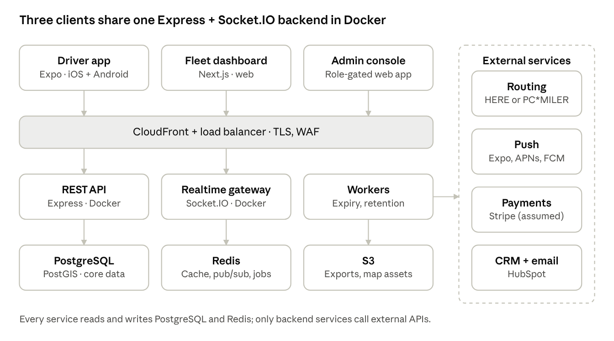

# 04 System Architecture Document

TruckBeez runs as a modular monolith: one Express REST API, one Socket.IO realtime gateway and one worker service, each a Docker container sharing PostgreSQL/PostGIS and Redis. Routing is hidden behind an internal interface so HERE or Trimble PC*MILER can be swapped without client changes.

## System context

Clients reach the backend only through the edge layer; the backend alone talks to routing, push, payments and HubSpot.

## Components

| Component | Tech | Responsibility | Scales by |
| --- | --- | --- | --- |
| Driver app | Expo SDK, React Native, TypeScript, Mapbox/HERE map SDK [Assumption] | Navigation UI, background location, hazard reports, offline route cache | App stores |
| Fleet dashboard + admin | Next.js, React, TypeScript | Live map, reports, billing, moderation | CDN + container replicas |
| REST API | Node.js 20, Express, Zod validation | Auth, profiles, routing proxy, fleets, reports, billing | Horizontal (ECS tasks) |
| Realtime gateway | Socket.IO + Redis adapter | Location ingest, live fleet map, hazard fan-out | Horizontal, sticky sessions at the load balancer |
| Workers | BullMQ on Redis | Hazard expiry, retention purge, PDF/CSV exports, HubSpot sync | Queue depth |
| PostgreSQL + PostGIS | AWS RDS | System of record, geospatial queries | Vertical + read replica |
| Redis | AWS ElastiCache | Route cache, Socket.IO pub/sub, job queues, rate limits | Cluster mode |
| S3 | AWS S3 | Report exports, offline map packs, backups | Managed |

## Key flows

1. **Route request:** app → `POST /v1/routes` → API loads truck profile + hazmat class → routing adapter calls HERE or PC*MILER with truck attributes → response normalised and cached in Redis (key = origin, destination, profile hash) → app.
2. **Live location:** app emits `location:update` every 5 s while on duty → gateway validates, writes latest position to Redis and batches to PostgreSQL every 30 s → publishes to the fleet room → dashboard updates the map.
3. **Hazard report:** app emits `hazard:report` → API stores it with a PostGIS point → gateway broadcasts to drivers whose route buffer (2 km) intersects it → worker expires it after 60 min unless confirmed.

## Routing adapter

`RoutingProvider` interface with `calculateRoute`, `reroute`, `getRestrictions` and `estimateTolls`. Two implementations, `HereProvider` and `PcMilerProvider`, are built during the spike; the winner ships and the other stays as fallback. Caching must respect the licence terms of the chosen provider.

## Security architecture

- JWT access tokens (15 min) + rotating refresh tokens (30 days) in secure storage (Keychain / Keystore via `expo-secure-store`).
- RBAC: driver, fleet_owner, dispatcher, viewer, admin; checked in API middleware and in Socket.IO room joins.
- TLS 1.2+ everywhere, AWS WAF at the edge, rate limiting per user and IP in Redis.
- Secrets in AWS Secrets Manager; no secrets in the Expo bundle.
- Location data encrypted at rest (RDS + S3 KMS); PII access logged in the audit table.

## Mobile architecture

- State: React Query for server state, Zustand for local state [Assumption].
- Background location: `expo-location` + `expo-task-manager`, adaptive sampling (1 s when navigating at speed, 5–30 s when stationary) to meet the 7%/hour battery budget.
- Offline: active route geometry, instructions and tiles cached; reports queued and sent when back online.
- Releases: EAS Build + EAS Submit; OTA updates via EAS Update for JS-only fixes.

## Architecture decisions

| ADR | Decision | Status |
| --- | --- | --- |
| ADR-001 | Express + Socket.IO over NestJS for the API | Accepted |
| ADR-002 | Expo for the mobile app | Accepted |
| ADR-003 | Docker containers for unit, staging, pre-production, production | Accepted |
| ADR-004 | Routing provider: HERE vs Trimble PC*MILER | Proposed (spike) |
| ADR-005 | PostgreSQL + PostGIS as the system of record | Proposed |
| ADR-006 | AWS ECS Fargate as the container platform | Proposed |

---
*Part of the [TruckBeez SDLC documentation set](README.md). Status: Draft v0.1 (2026-11-04).*
