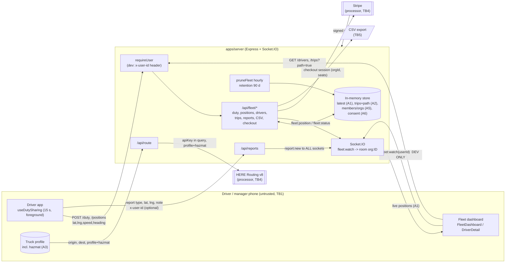

# Threat model: fleet live tracking and driver location privacy (BR-55)

| | |
|---|---|
| Owner | `truckbeez-security-engineer` |
| Status | Draft for review. Re-run this model when BR-45 (real auth + Postgres) lands |
| Scope | TruckBeez Fleet as built in PR #3 (`feat/BR-38-starter-app-and-fleet` @ `9da1a14`) plus PR #10 (HERE routing): `apps/server/src/fleet/*`, `src/index.ts` (Socket.IO), `src/routes/{route,reports}.ts`, `apps/mobile` fleet screens, `useDutySharing` |
| Method | STRIDE per element, using the data-flow diagram below. Likelihood (L) and Impact (I) are rated 1 (low) to 3 (high). Risk = L × I: **7–9 Critical, 5–6 High, 3–4 Medium, 1–2 Low** |
| Related | `CLAUDE.md` non-negotiables "Hazmat correctness beats route speed" and "Location data is sensitive", `docs/secrets.md` (PR #11), `docs/legal/privacy-policy.md` (legal pack branch) |

> **Today's code is a development build.** Identity is a self-asserted `x-user-id` header (`fleet/auth.ts`), and the `fleet:watch` socket event trusts a user id sent by the client (`src/index.ts:32`). That is acceptable **only** on a developer machine with fake data. Section 9 lists what must be true before any real driver, real location or real hazmat load touches this system.

---

## 1. Assets

| # | Asset | Where it lives today | Why it matters | Sensitivity |
|---|---|---|---|---|
| A1 | **Live driver position** (lat/lng, speed, heading, timestamp) | `latest` Map (`fleet/store.ts`), `fleet:position` socket events | Real-time physical location of a person and of a truck with cargo. It enables stalking and cargo theft | **Restricted** |
| A2 | **Breadcrumb trail** (`Trip.path`, ~1 point/min while on duty) | `trips` Map, `/drivers/:id/trips?path=true` | Reveals routines, shift start and end points (often home), overnight parking and customer sites | **Restricted** |
| A3 | **Hazmat load info** (hazmat categories, tunnel category) | Device `TruckProfileContext`, `/api/route` request body, HERE request | Combined with A1 or A2, it is a targeting map for theft or attack (explosives, poison inhalation, radioactive) | **Restricted, highest**. Never combined with A1/A2 outside the owning fleet |
| A4 | Trip summaries and fleet reports (distance, driving/idle hours, off-route events, reports filed) | `fleetReport`, CSV export | Employment decisions get made from it. Integrity matters as much as confidentiality | Confidential |
| A5 | Fleet tenant data (org, members, roles, invites) | `orgs`, `members`, `invites` Maps | Cross-tenant leaks expose a competitor's drivers and customers | Confidential |
| A6 | Driver consent record (`consentAt`) | `Member.consentAt` | Legal basis for tracking. It must be provable and revocable | Confidential (integrity-critical) |
| A7 | Credentials and session identity | `x-user-id` (dev). Later OIDC tokens | Whoever holds it acts as the driver or owner | Secret |
| A8 | Billing state (Stripe customer/subscription ids, plan, seats) | `Org`, Stripe | Paywall integrity and revenue. Must stay in PCI SAQ A scope | Confidential |
| A9 | Community reports (type, location, note, confirmations) | `reports` Map, global `report:new` broadcast | Integrity: fake closures or "weigh station closed" reports send trucks into danger | Public data, integrity-critical |
| A10 | Third-party keys (HERE, Stripe) | `process.env` in `apps/server` | Billing abuse, outage, data access | Secret (see `docs/secrets.md`) |

## 2. Actors

| Actor | Trust | Notes |
|---|---|---|
| Driver (fleet member) | Authenticated user (dev: self-asserted) | Controls on-duty and leave. Must never see other drivers |
| Dispatcher | Authenticated, org-scoped | Sees live map and trips of own org only |
| Fleet owner | Authenticated, org-scoped, billing authority | Invites, billing, CSV export. MFA required in production |
| Solo driver (no fleet) | Authenticated | Routing and reports only. No fleet data |
| Anonymous internet client | Untrusted | Today it can reach `/api/route`, `/api/reports` and the Socket.IO endpoint without auth |
| Malicious insider at a fleet | Authenticated but adversarial | E.g. an ex-dispatcher, or an owner tracking off-duty drivers |
| Organised cargo-theft actor | Untrusted, motivated | Targets hazmat and high-value loads |
| HERE (routing processor) | Third-party processor | Receives origin, destination, truck profile and hazmat |
| Stripe | Third-party processor | Receives org id, seats. Never card data via our servers |

## 3. Trust boundaries

- **TB1 Device ↔ API.** Everything the app sends is untrusted: identity, coordinates, speed, `offRoute`, duty state, report contents.
- **TB2 API ↔ Socket.IO room.** Joining `org:<id>` grants a stream of A1. This boundary is enforced only once, at join time.
- **TB3 Tenant ↔ tenant.** Every query must be scoped by the org id taken from the server-side session, never from client input.
- **TB4 API ↔ HERE / Stripe.** These are outbound calls with secrets. Inbound Stripe webhooks are trusted only after signature verification.
- **TB5 Fleet dashboard ↔ exported files.** A CSV leaves our control once it is downloaded and is opened in spreadsheet software.
- **TB6 On-duty ↔ off-duty.** This is a privacy boundary in time, not in the network: fleet visibility must stop when duty stops.

## 4. Data-flow diagram

## 5. STRIDE threats

Code references are to PR #3 @ `9da1a14` unless noted.

| ID | STRIDE | Element | Threat | Evidence in code | L | I | Risk | Mitigation (target) |
|---|---|---|---|---|---|---|---|---|
| T1 | **S**poofing | Auth | Anyone sets `x-user-id` to any value and becomes that driver, dispatcher or owner. Dispatchers receive driver ids (`driverId` = user id) from `/drivers`, so they can impersonate drivers | `fleet/auth.ts:10-17`, `store.ts:218-224` | 3 | 3 | **9 Critical** (dev only) | BR-45: OIDC, short-lived access JWT + rotating refresh tokens, Keychain/Keystore storage. Identity comes only from a verified token `sub`. Remove the `ALLOW_DEV_AUTH` escape hatch from production builds entirely (compile-time, not an env flag) |
| T2 | **S**poofing / **I**nfo disclosure | Socket.IO | `fleet:watch(userId)` trusts a client-sent id. Anyone who knows or guesses an owner or dispatcher id streams that fleet's live positions. CORS `*` | `index.ts:15,32-37` | 3 | 3 | **9 Critical** (dev only) | Authenticate in the Socket.IO `auth` handshake with the access token. Derive `orgId` and role server-side. No client-supplied ids. Restrict CORS origins |
| T3 | **E**levation / **I** | Socket.IO | Room membership is checked **once**. A dispatcher who is removed or demoted, or a fleet whose plan lapses, keeps receiving positions until it disconnects. `fleet:watch` does not check `isActive(org)`, so it bypasses the paywall too | `index.ts:32-37` vs `routes.ts:44-50` | 2 | 3 | **6 High** | Check `isActive` and role on join. On role, plan or membership change, call `io.in(userSockets).socketsLeave(orgRoom)`. Re-validate on token refresh. Expire sockets with the access token |
| T4 | **I**nfo disclosure | Tenant boundary | Cross-tenant read through an IDOR on `/drivers/:id/trips`, reports or CSV. **Today it is correctly scoped** (`driver.orgId !== org.id` → 404, and `tripsFor` filters by `orgId`). The risk is regression during the Postgres migration | `routes.ts:171-180`, `store.ts:227-232` | 2 | 3 | **6 High** | Postgres Row-Level Security keyed on `app.current_org_id` set from the token. Every repository function takes `orgId` as a required first argument. Use opaque per-org member ids, not global user ids. Cross-tenant test suite (QA-X*) in CI as a blocking gate |
| T5 | **I** (privacy) | On/off-duty boundary | Location visible while off duty. Server side this is correct today: `/positions` returns 409 when off duty, `setDuty(false)` deletes `latest`, and `fleetDrivers` returns `position: null`. Risks: (a) background location in BR-5 keeps sending after off duty; (b) the dashboard caches the last position; (c) a trip never ends (app killed while on duty), so the trail grows indefinitely; (d) the privacy policy draft says "on duty **or navigating for that fleet**", which is broader than the code | `store.ts:130-141,172-175,222`, `useDutySharing.ts` | 2 | 3 | **6 High** | Server is the source of truth. Auto-end a trip after N hours with no fix, and at 14 h (a HOS-style shift cap) send a prompt. Stop the background task when duty ends. The dashboard clears the marker on `off_duty`, which it already does. Align the policy text with the code (legal review). QA-D* tests |
| T6 | **I** (privacy) | Breadcrumbs | Trails reveal home address and routines. Shift start and end points are usually at or near home | `store.ts:196-199` | 3 | 2 | **6 High** | Trim the first and last ~1 km of each trip path before it is visible to the fleet (privacy zone). Optionally let the driver set a home zone that is never shown. Route replay only on plans that include it (already the case), and only for owner/dispatcher roles |
| T7 | **I** | Hazmat | Hazmat category plus live position leaks to anyone who is not the owning fleet's authorised staff (other fleets, community reports, logs, analytics, HERE retention) | `/api/route` body. Hazmat is **not** stored server-side today, which is good | 2 | 3 | **6 High** | Section 7 rules. Never persist hazmat with a position outside the tenant. Never log a route request body. Check HERE's data-retention terms (legal) |
| T8 | **T**ampering | Positions | A driver spoofs GPS (mock location app) to fake route adherence or hide a stop. An impostor (T1) injects fake positions into a fleet's map | `routes.ts:144-160`. `MAX_PLAUSIBLE_MPS` only skips distance accrual, and the fix is still accepted and broadcast | 2 | 2 | **4 Medium** | Flag (don't drop) impossible-speed or teleport fixes and show "GPS unreliable" to the dispatcher. Mobile mock-location and root/jailbreak detection reports a flag. Server timestamps only (the zod schema already strips `at`, so keep it that way) |
| T9 | **T**ampering | Community reports | `/api/reports` is unauthenticated. `confirm` can be called unlimited times by one actor (keeps a fake closure alive). `x-user-id` on a report bumps **any** driver's `reportsFiled` count in fleet reports | `reports.ts:29-44`, `lib/store.ts:35-40` | 3 | 2 | **6 High** | Auth required. One confirmation per user per report. Rate limits (Redis). Reputation weighting. Reporter must be within X km of the report (server-checked against their latest fix). Credit `reportsFiled` only from the authenticated caller |
| T10 | **T**ampering | CSV export | CSV/formula injection: a driver's display name (from `x-user-name`, at most 60 characters) such as `=HYPERLINK(...)` runs when the owner opens the export in Excel or Sheets | `store.ts:252-262` (escapes quotes only) | 2 | 2 | **4 Medium** | Prefix any cell starting with `= + - @ \t \r` with `'`. Validate display names (letters, digits, spaces, `.-'`) |
| T11 | **S** / **E** | Invites | Invite codes are 6 hex characters (24 bits) with no attempt limit on `/join`. Brute force lets an outsider join a fleet as a "driver", consume seats (DoS) and inject fake positions. Joining is immediate, without owner approval | `store.ts:90`, `routes.ts:107-120` | 2 | 2 | **4 Medium** | 10+ character codes from a base32 alphabet (at least 50 bits). Rate-limit `/join` per user and IP, and lock out after N failures. Owner approves new members. Single use, which is already the case |
| T12 | **R**epudiation | Consent and duty | `consentAt` is a timestamp only: no consent text version, no withdrawal record, no audit of who viewed a driver's trail | `store.ts:106`, `types.ts` | 2 | 2 | **4 Medium** | Append-only audit log: consent given or withdrawn (with policy version), duty changes, every manager view or export of A1/A2 (who, when, which driver). Drivers can see who viewed their data (transparency) |
| T13 | **T** / **E** | Billing | (a) With `STRIPE_SECRET_KEY` unset, `/billing/checkout` activates a plan for free (demo mode is not tied to the environment). (b) The webhook trusts `checkout.session.completed` without checking `payment_status`, with no event-id dedupe and no ordering, so an old `subscription.updated` can re-activate a cancelled plan | `billing.ts:27-31,62-81` | 2 | 2 | **4 Medium** | Demo billing only when `APP_ENV` is `development` or `unit`. Store processed `event.id`s (idempotency). Compare `event.created` or re-fetch the subscription from Stripe before applying. Check `payment_status === "paid"`. The signature check is already correct (raw body, `constructEvent`) |
| T14 | **D**enial of service | API | No rate limits anywhere. `/api/route` costs money per call (HERE). `/api/reports?radiusKm=1e9` dumps every report. Body-size defaults only | `route.ts`, `reports.ts:21` | 3 | 2 | **6 High** | Redis rate limiter per user and IP. Cap `radiusKm` (e.g. ≤ 100). Cap route distance. HERE budget alerts. See PR #10 review M2 |
| T15 | **I** | Retention | Data kept longer than stated. `FLEET_RETENTION_DAYS` that is not a number gives `NaN`, so **nothing is ever pruned** (verified). An empty value gives `0`, so ended trips are deleted at the next hourly prune. Trips of drivers who left stay for 90 days but nobody can reach them for export or deletion. Never-ended trips are never pruned | `store.ts:26,264-276` | 2 | 2 | **4 Medium** | Validate at startup (integer 1–90, fail closed). Prune by `endedAt ?? lastFixAt`. Implement export and delete for drivers (data subject rights). Section 6 |
| T16 | **I** | Logs and telemetry | Coordinates, hazmat or keys end up in logs or APM (`console.log` of request bodies, HERE URL with `apiKey`) | `index.ts:28` logs `socket.id` only (fine). PR #10 review M1 | 2 | 2 | **4 Medium** | Structured logger with a deny-list (`lat`, `lng`, `path`, `hazmat`, `apiKey`, `authorization`). Never log request bodies on `/fleet/positions` or `/route`. APM query-string scrubbing |
| T17 | **I** | Global broadcast | `report:new` goes to **every** connected socket. Reports carry no user id today, which is good. If a reporter id or org id is ever added, every client learns who was where | `reports.ts:35` | 1 | 2 | **2 Low** | Keep reports anonymous on the wire. Broadcast by geo-cell room, not globally (privacy and scale) |
| T18 | **I** | Third parties | HERE receives origin, destination and hazmat for every route, and Stripe receives org metadata | `hereRouting.ts` (PR #10) | 1 | 2 | **2 Low** | DPAs with HERE and Stripe. Confirm HERE request-log retention. Record both in the vendor register (SOC 2). **Legal review** |

## 6. Retention per data class

The **today** column reflects the code. The **target** column is the policy BR-45 must implement. A fleet may **shorten**, never lengthen, a target without security and legal sign-off.

| Data class | Today | Target retention | After expiry | Notes |
|---|---|---|---|---|
| Live position (A1) | Until off duty or leave (`latest.delete`), in memory | Redis key TTL **15 min** after the last fix, and deleted immediately on off duty or leave | Deleted | Never written to Postgres. History is A2 |
| Breadcrumbs `Trip.path` (A2) | **90 days** after `endedAt` (`FLEET_RETENTION_DAYS`, default 90). Never-ended trips are never pruned | **90 days max** after trip end. Auto-end trips after 14 h or after 2 h without a fix | Path deleted. The trip summary is kept without geometry | Fleet-configurable 7–90. Validate the env var (T15) |
| Trip summaries / fleet reports (A4) | Same as trips (deleted with them) | **24 months** | Deleted or aggregated per org per month | **Legal review**: employment-record and FMCSA record-keeping needs vary. TruckBeez is not an ELD |
| Hazmat profile (A3) | Device only. In transit to HERE per request | Device only. **Not stored server-side**. If ever stored, only with the vehicle record and never with A1/A2 history | n/a | See section 7 |
| Route requests (origin, destination, profile) | Not stored | **Not stored**. Metrics only (count, latency, outcome) | n/a | Coordinates are never logged |
| Community reports (A9) | TTL per type: 30 min (police) to 30 days (low clearance) | Same TTLs. Abuse and moderation metadata (reporter id, IP hash) **30 days** | Deleted | Reporter identity is never public |
| Invites | 7 days, or until used | 7 days | Deleted | |
| Consent and audit log (A6, T12) | `consentAt` only | **Membership + 3 years** (proof of consent and of who viewed what) | Deleted | **Legal review** of the period |
| Billing (A8) | In memory | As required by tax law (typically 7 years) in Stripe. We keep only ids | n/a | **Legal review** |
| Application logs | stdout | **30 days**, no coordinates or PII | Deleted | |
| Backups | n/a | **30 days** (per the security strategy) | Rotated out | Deletion requests are honoured once the backup window passes. Document this in the privacy policy |
| Analytics / product telemetry | none | Location reduced to **~1 km** (2 decimal places or H3 res 7), aggregated, k ≥ 10 drivers per cell, **13 months** | Deleted | Never per-driver location in analytics |

## 7. Hazmat load visibility rules

These follow from the security crown jewel "hazmat load information" and the CLAUDE.md non-negotiable "Hazmat correctness beats route speed". DOT/FMCSA hazmat security-plan obligations (49 CFR Part 172 Subpart I) sit with the **carrier**. Whether and how TruckBeez supports them needs **legal review**. These rules are the app-side minimum:

1. **Need-to-know.** Only the owning fleet's owner and dispatchers may see that a specific truck carries hazmat, and only while that driver is on duty. Drivers of other fleets, solo drivers and anonymous clients never see it.
2. **Never public.** Hazmat class, placard or load status never appears in community reports, `report:new` broadcasts, public share links, ETA share links, or anything rendered to non-members.
3. **Never combined outside the tenant.** A hazmat flag and a live or historical position are never in the same payload unless it goes to an authorised member of that fleet (rule 1). Fleet CSV exports omit hazmat by default. Including it requires an explicit owner action, which is audit-logged.
4. **Minimise server-side.** Today hazmat lives on the device and is sent per routing request. Keep it that way, or store it only on the vehicle/trip record under RLS. Never log it. The deny-list logger covers `hazmat`, `shippedHazardousGoods` and `tunnelCategory`.
5. **Third parties.** HERE receives hazmat only as routing input. There is no other sharing.
6. **Analytics.** Hazmat trips are excluded from any location heat-map product, or aggregated with k-anonymity and delay (≥ 24 h, ~10 km cells).
7. **Display.** The fleet map uses a neutral marker for hazmat trucks. Hazmat shows only on the driver detail screen and requires a tap. No placard icons on the overview map (shoulder-surfing, screenshots).

## 8. Security test cases for QA (`truckbeez-qa-automation-engineer`)

These are API-level tests (Jest/Vitest plus supertest, and `socket.io-client`). In the dev build, "as user U" means sending `x-user-id: U`. After BR-45 it means a token for U. **All X* and D* tests block the merge.**

### Cross-tenant (X)

| ID | Setup | Action | Expected |
|---|---|---|---|
| X1 | Org A (owner OA, driver DA), org B (owner OB, driver DB), both active | OB `GET /api/fleet/drivers/DA/trips` | 404 "Driver not found in your fleet". The body contains no DA data |
| X2 | Same | OB `GET /drivers`, `/reports/summary`, `/reports/export.csv` | Only DB appears. DA's id and name are absent from every response |
| X3 | Same; OB socket `fleet:watch` | DA goes on duty and posts positions | OB's socket receives **no** `fleet:position` or `fleet:status` for DA within 5 s |
| X4 | After BR-45: OB's token | Socket handshake with OB's token, then emit `fleet:watch` with OA's id or org id | Rejected. Server-derived org only |
| X5 | Dispatcher of A is removed or demoted, or A's plan lapses (trial expiry or `subscription.deleted` webhook) | DA posts a position | The previously joined socket stops receiving within 1 s (covers T3; **fails today**) |
| X6 | Org A with plan inactive | OA socket `fleet:watch` | `{ok:false}` (**fails today**: the paywall is not checked on the socket) |
| X7 | Driver DA | DA `GET /drivers`, `/drivers/DB/trips`, socket `fleet:watch` with DA's id | 403 / `{ok:false}` |
| X8 | Two orgs | Brute-force `/join` with random codes, 1000 attempts | Rate limited (429) after N attempts. No membership created (**fails today**) |
| X9 | DA leaves A and joins B | OB `GET /drivers/DA/trips` | Only trips recorded under B. None of A's history |
| X10 | Postgres (BR-45) | Run every repository read with `app.current_org_id` set to A | No row with `org_id = B` is ever returned (RLS test at the DB layer) |

### Off-duty and privacy leaks (D)

| ID | Setup | Action | Expected |
|---|---|---|---|
| D1 | DA has consented and is **off duty** | `POST /positions` | 409. Nothing stored, nothing emitted |
| D2 | DA on duty with a position, OA watching | DA `POST /duty {onDuty:false}` | OA gets `fleet:status off_duty`. `GET /drivers` shows `position: null` for DA. No later `fleet:position` |
| D3 | D2, then an in-flight `/positions` request lands after off duty | Race: send the position 10 ms after `/duty false` | 409. No emit |
| D4 | DA leaves the fleet while on duty | `POST /leave` | `fleet:status left`. DA gone from `/drivers`. `latest` cleared. The active trip has `endedAt` |
| D5 | Driver who has not joined a fleet (no consent) | `POST /duty`, `/positions` | 403 |
| D6 | `POST /join` without `consent: true` | | 400 with the consent message. No membership |
| D7 | Trip with path, Starter plan (no `routeReplay`) | OA `GET /trips?path=true` | No `path` field |
| D8 | Trip with path, Pro plan, after the privacy-zone fix | OA `GET /trips?path=true` | The first and last ~1 km of points are absent |
| D9 | Trip ended 91 days ago (clock injected) | Run `pruneFleet` | Trip deleted |
| D10 | `FLEET_RETENTION_DAYS=abc` / empty / `365` | Start server | Refuses to start (**fails today**: `NaN` means never prune, empty means 0) |
| D11 | App: mobile E2E (Appium) | Toggle off duty, then background the app for 2 min | Mock server receives zero `/positions` calls |
| D12 | Any request on `/positions`, `/route` | Inspect server logs | No `lat`, `lng`, `path`, `hazmat` or `apiKey` values appear |
| D13 | Driver display name `=HYPERLINK("http://x","y")` | Owner exports CSV | The cell starts with `'` (T10) |
| D14 | Hazmat profile set | Create a community report, and connect as a solo driver | No hazmat field in any `report:*` event or `/reports` response |

Auth and billing cases for BR-45 (expired token, refresh-token reuse detection, forged Stripe webhook, replayed webhook `event.id`, `checkout.session.completed` with `payment_status=unpaid`) go in the BR-45 test plan.

## 9. Conditions for BR-45 (real auth + Postgres)

BR-45 is **done** only when every item below is true and verified by an automated test. Until then, the server must refuse fleet endpoints in any deployed environment. That is the case today (`requireUser` returns 503 in production), but the guard keys on `NODE_ENV` and has an `ALLOW_DEV_AUTH` override, both of which BR-45 removes.

**Identity and sessions**
1. OIDC (Authorization Code + PKCE) through a managed IdP. Access JWT ≤ 15 min. Rotating refresh tokens with reuse detection. Tokens stored in Keychain/Keystore (`expo-secure-store`), never in AsyncStorage.
2. MFA enforced for owner and dispatcher roles.
3. `x-user-id` / `x-user-name` and `ALLOW_DEV_AUTH` are removed from production code paths (a build-time flag, with a test that proves the header is ignored).
4. Socket.IO authenticates in the handshake (`auth.token`). `fleet:watch` takes **no arguments**. Org and role come from the token and the DB. Sockets are disconnected on token expiry, role change, membership removal and plan lapse (X4–X6).

**Authorisation and tenancy**
5. Postgres Row-Level Security on every tenant table (`orgs`, `members`, `trips`, `positions`, `invites`, `audit_log`), with `SET app.current_org_id` per request from the token. The app DB role has no `BYPASSRLS`. X10 passes.
6. Roles `owner`, `dispatcher`, `driver` are enforced in one policy module. Object-level checks exist on every `:id` route (X1–X9 pass).
7. Members are exposed by an opaque per-org `member_id`, never by the IdP `sub` or a global user id.

**Location privacy**
8. Live positions go in Redis with a 15 min TTL. Breadcrumbs go in Postgres/PostGIS with a retention job that is idempotent, monitored and alerting. Retention config is validated at startup (D10).
9. Privacy-zone trimming of trip start and end (D8). Auto-end of stale trips.
10. Consent is versioned (`consent_version`, `consented_at`, `withdrawn_at`). Withdrawal stops sharing immediately. Audit log of manager views and exports (T12).
11. Driver data export (JSON) and delete-on-request endpoints, with the backup-window caveat documented.
12. Background location (BR-5) stops on off duty, enforced on the device and on the server (D1, D11).

**Abuse and integrity**
13. Rate limits (Redis): `/join`, `/positions`, `/reports`, `/reports/:id/confirm` (one per user), `/route`. Report confirm and the `reportsFiled` count are tied to the authenticated user (T9).
14. GPS plausibility flags and mock-location flags shown to dispatchers (T8).
15. Invite codes with at least 50 bits of entropy, lockout after failures, owner approval (T11).
16. CSV formula-injection escaping (T10). Display-name validation.

**Billing**
17. Demo billing only in `development`/`unit`. Webhook idempotency on `event.id`, ordering checks, and `payment_status` check (T13).

**Ops**
18. Deny-list structured logger in `apps/server`, plus `Secret` handling from PR #11 for HERE and Stripe keys (T16, PR #10 review M1).
19. CORS restricted to the dashboard origin(s). Security headers (helmet). Generic error bodies.
20. This threat model is re-reviewed against the BR-45 implementation, and `truckbeez-security-engineer` signs off in the PR.

**Legal review needed before launch** (not legal conclusions): employee-monitoring notice and consent rules by state (e.g. NY Civil Rights Law §52-c electronic-monitoring notice, CCPA/CPRA "sensitive personal information" for precise geolocation), the privacy-policy wording "on duty or navigating for that fleet" versus what the code does, retention periods for A4/A6, HERE and Stripe DPAs, and how hazmat security-plan obligations apply to what the fleet dashboard displays.

## 10. Hand-offs

| To | What |
|---|---|
| `truckbeez-fullstack-engineer` | T3, T5–T11, T13–T16 fixes, and the BR-45 conditions 1–19 |
| `truckbeez-qa-automation-engineer` | Section 8 suites (X*, D*), blocking in CI |
| `truckbeez-devops-specialist` | Redis rate limiter, RLS migration checks in CI, log deny-list and APM scrubbing, retention-job monitoring |
| `truckbeez-uiux-designer` | Hazmat display rules (section 7.7), transparency screen ("who viewed my trips"), off-duty state that is clearly visible to the driver |
| `truckbeez-data-engineer-analyst` | Analytics precision reduction and k-anonymity (section 6) |
| Owner / legal | Items marked **Legal review** |
